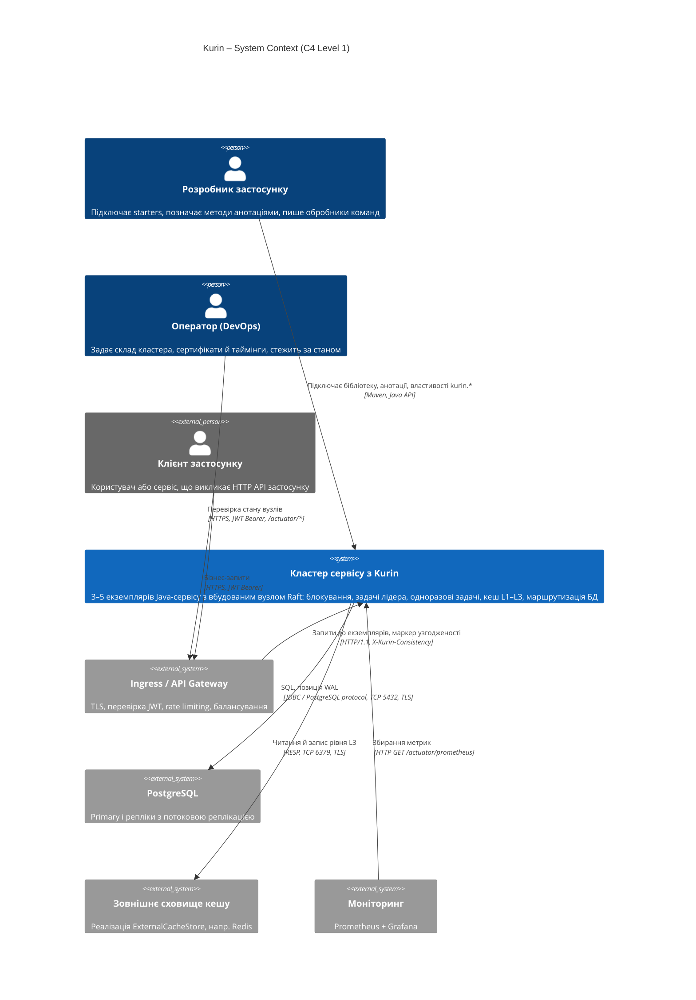
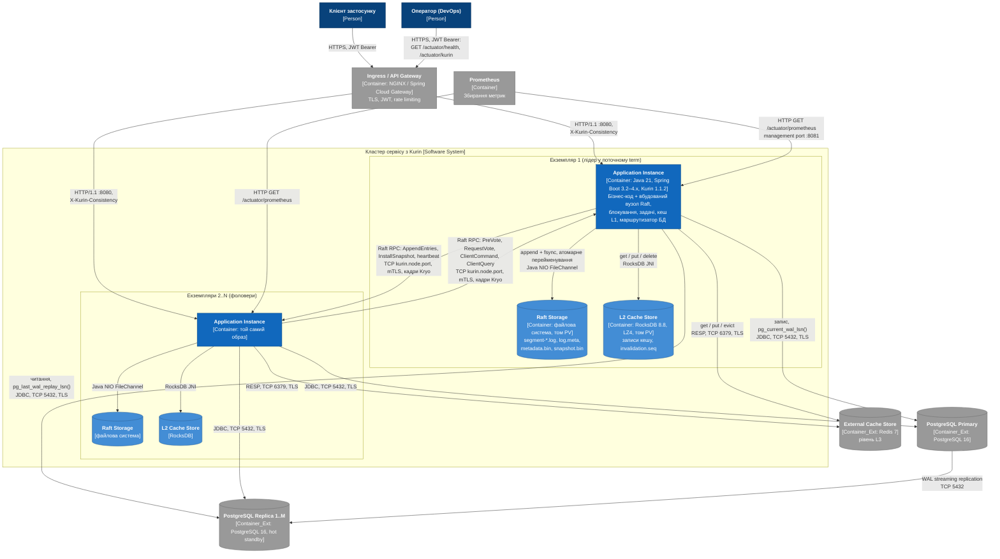
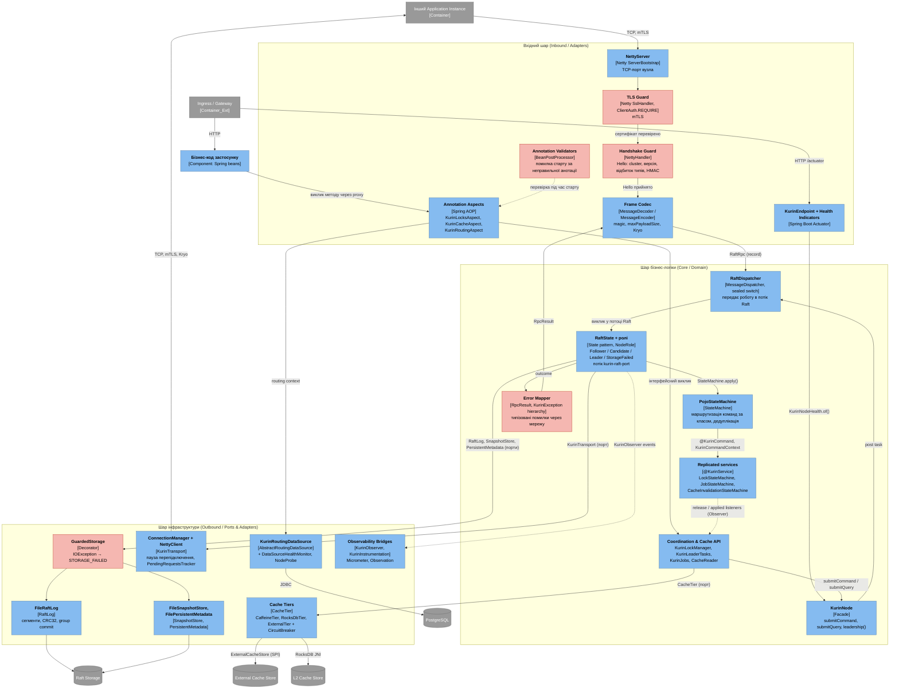
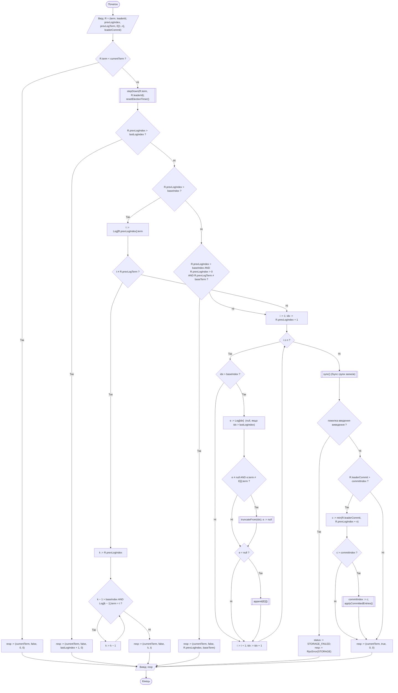
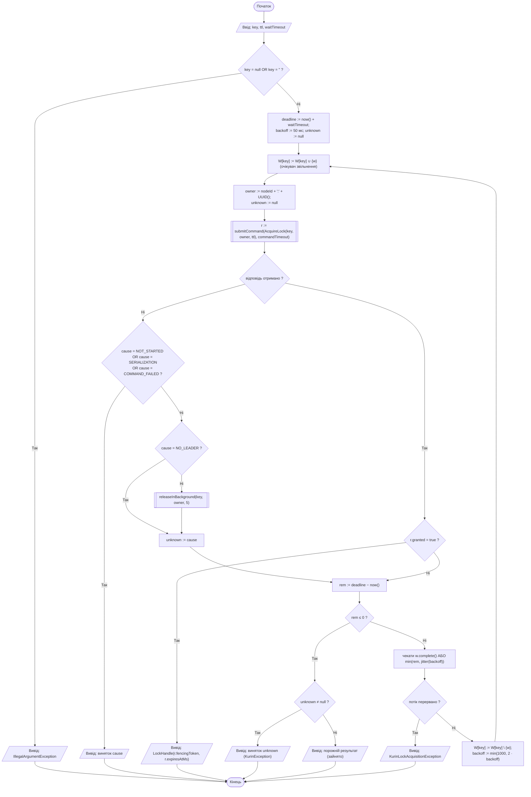
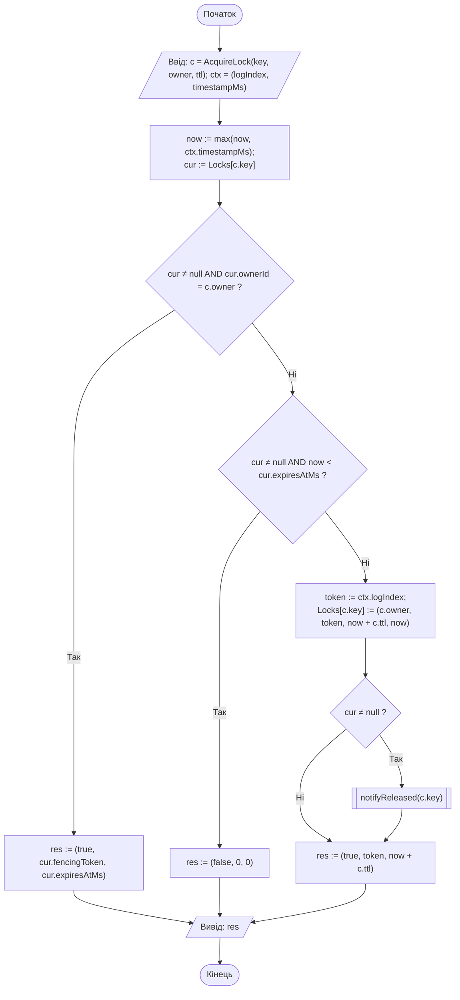
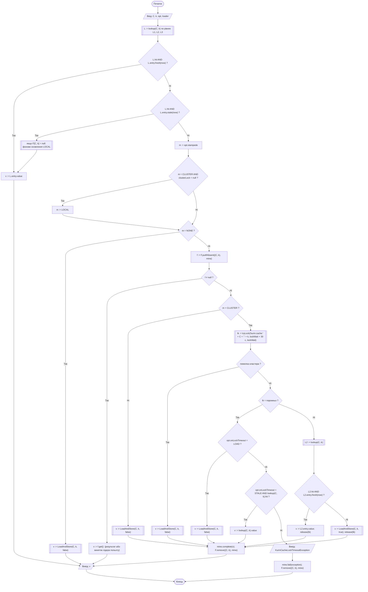
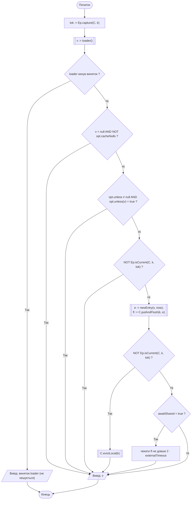
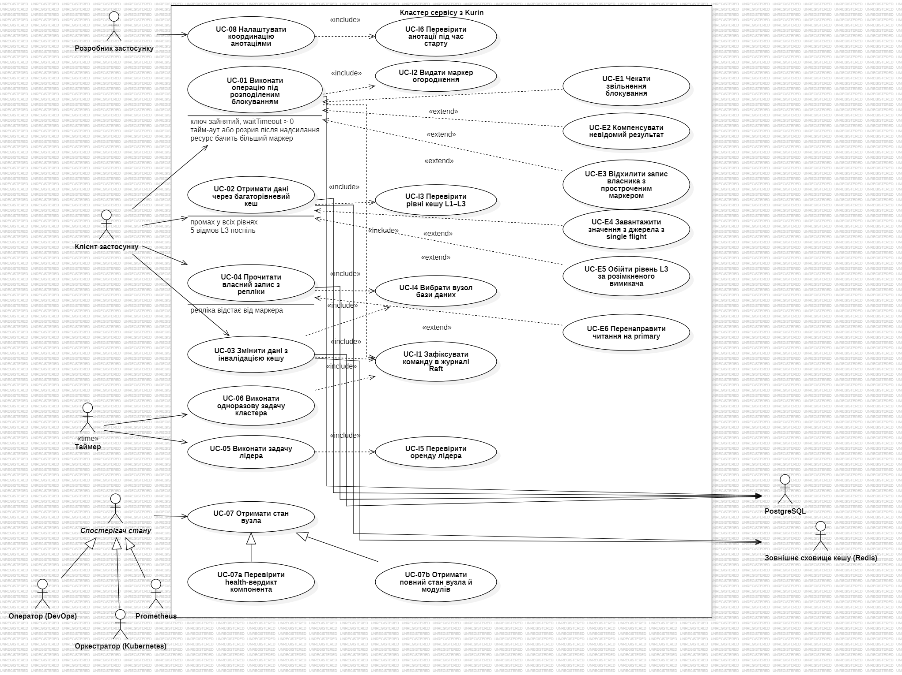
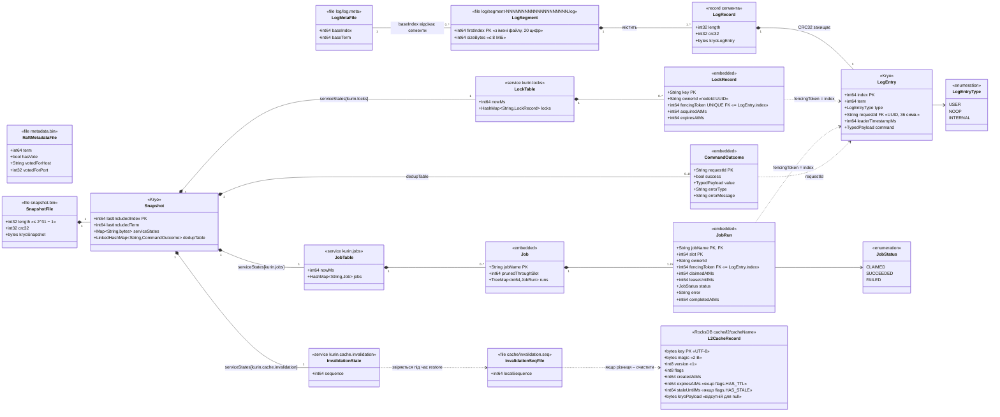

# РОЗДІЛ 2. ОБҐРУНТУВАННЯ АРХІТЕКТУРНИХ РІШЕНЬ ТА ПРОЄКТУВАННЯ СИСТЕМИ

Розділ спирається на інженерний контракт [srs.md](./srs.md) (ISO/IEC/IEEE 29148) і фіксує архітектурний стиль
Kurin, модель C4 (рівні 1–3), контур безпеки, контракти протоколу й карту маршрутів, сценарії використання,
модель даних, алгоритми критичних вузлів і результати інтеграційного аудиту. Діаграми C4, даних і алгоритмів
записано кодом Mermaid і відображаються GitHub без додаткових інструментів; діаграму прецедентів побудовано в
CASE-засобі StarUML.

Позначення трасування: `→ SRS-FUN-NN` – вимога, яку реалізує елемент; `→ ADR-NNN` – рішення, на якому він
ґрунтується.

---

## 2.1. Обґрунтування архітектурного стилю та патернів проєктування

### 2.1.1. Глобальний архітектурний стиль

Kurin реалізує стиль **вбудованого реплікованого автомата станів** (embedded replicated state machine): фреймворк
є бібліотекою, що працює в процесі кожного з N однакових екземплярів Java-сервісу (N = 3 або 5,
[SRS-NFR-SCAL-01](./srs.md#srs-nfr-scal-01)), а екземпляри узгоджують спільний стан протоколом Raft. За
класифікацією розгортання це **модульний моноліт, тиражований без спільного стану між вузлами**
(shared-nothing): кожен екземпляр має власний журнал Raft і власне сховище L2, а спільними є лише впорядковані
команди журналу. Мікросервісної декомпозиції фреймворк не вводить: модулі `core`, `kurin-locks`,
`kurin-tiered-cache`, `kurin-data-routing` – це Maven-артефакти однієї JVM, а не окремі процеси
([2.2.2](#222-рівень-2--container-diagram)). Усередині процесу код організовано за **гексагональною
архітектурою (Ports & Adapters)**: ядро Raft залежить лише від портів `RaftLog`, `SnapshotStore`,
`PersistentMetadata`, `KurinTransport`, `CacheTier`, а Netty, файлова система й RocksDB – адаптери.

Розглянуто три альтернативи:

| Варіант | Суть | Чому відхилено або обрано |
| :--- | :--- | :--- |
| A. Зовнішній сервіс координації (etcd, ZooKeeper) + клієнтська бібліотека | окремий кластер із 3 процесів, застосунок звертається до нього мережею | порушує [SRS-NFR-INF-01](./srs.md#srs-nfr-inf-01) (без зовнішніх сервісів координації); додає 3 процеси на середовище й мережевий перехід на кожну операцію блокування |
| B. Sidecar-процес поруч з кожним екземпляром | вузол Raft в окремому контейнері поду, обмін через localhost gRPC | серіалізація й перемикання процесів на кожну команду; два життєві цикли, які треба узгоджувати під час збою; POJO застосунку потребували б IDL ([ADR-001](./adr/0001-choice-of-technology.md)) |
| **C. Вбудований вузол (обрано)** | вузол Raft – об'єкт у JVM застосунку | виклик `submitCommand` – виклик методу без додаткового процесу; один життєвий цикл зі Spring-контекстом; 0 додаткових процесів інфраструктури |

**Як стиль забезпечує NFR.**

- *Затримка* ([SRS-NFR-PERF-01](./srs.md#srs-nfr-perf-01), p95 ≤ 10 мс). Шлях команди на лідері – виклик
  методу, дописування в журнал, один мережевий обмін `AppendEntries` з більшістю й `fsync`. Додаткового
  мережевого переходу до зовнішнього координатора немає. Виміряно p95 = 1,9 мс на кластері з 3 вузлів.
- *Пропускна здатність* ([SRS-NFR-PERF-02](./srs.md#srs-nfr-perf-02), ≥ 5 000 команд/с). Групова фіксація
  (group commit) об'єднує в середньому 7,51 запису на один `fsync` ([SRS-NFR-SCAL-02](./srs.md#srs-nfr-scal-02));
  виміряно 10 755 команд/с.
- *Відмовостійкість* ([SRS-NFR-REL-01](./srs.md#srs-nfr-rel-01), новий лідер ≤ 3 000 мс). Вибори з PreVote і
  випадковим таймаутом [1 000; 2 000] мс; виміряно 2 158 мс.
- *Платформа* ([SRS-NFR-INF-01](./srs.md#srs-nfr-inf-01)). Стиль не вимагає брокера чи окремого сховища
  координації; FinOps-вартість – 0 додаткових процесів, проти 3 вузлів etcd і їхнього моніторингу у варіанті A.

**Ціна стилю (свідомі компроміси).**

1. *Масштабування запису вертикальне.* Усі команди проходять через одного лідера, тому додавання вузлів не
   збільшує пропускну здатність запису, а зменшує її (більше підтверджень). Межа – виміряні ≈ 10,7 тис.
   команд/с; Kurin призначено для координаційних даних (блокування, слоти задач, інвалідації), а не для
   бізнес-даних, які залишаються в PostgreSQL.
2. *CP за теоремою CAP.* Меншість вузлів після розділення мережі не приймає запис: команда завершується
   `KurinNoLeaderException` або `KurinTimeoutException`. Доступність обмінюється на лінеаризованість, бо
   «зайве» блокування гірше за відмову.
3. *Лідер – точка концентрації навантаження, але не єдина точка відмови.* Відмова лідера – це пауза запису до
   завершення виборів (≤ 3 с), а не втрата даних: підтверджені команди є на більшості вузлів
   ([SRS-NFR-REL-02](./srs.md#srs-nfr-rel-02): 0 втрачених на 197 716 командах під збоями).
4. *Каскадні збої синхронних викликів.* Фоловер пересилає команду лідеру синхронно, тому кожен виклик
   обмежено тайм-аутом (`commandTimeoutMs` = 5 000 мс, для блокувань `kurin.locks.command-timeout` = 3 с),
   а результат «невідомо» компенсується ([2.1.2](#212-патерни-мікрорівня), Idempotency Key, Fencing Token).
   Зовнішнє сховище L3 викликається через Circuit Breaker, тому його відмова не блокує потоки застосунку.
5. *Прив'язка до JVM.* Вбудований вузол існує лише для Java 21+; сервіси іншою мовою в кластер не входять
   ([ADR-001](./adr/0001-choice-of-technology.md), Consequences).

### 2.1.2. Патерни мікрорівня

| Патерн | Де реалізовано | Яку проблему зв'язності або ізоляції розв'язує |
| :--- | :--- | :--- |
| Replicated State Machine + Command | `@KurinCommand`-методи сервісів, команди – Java-record (`AcquireLock`, `ReleaseLock`) | стан змінюється лише детермінованим застосуванням команд журналу; вузли не обмінюються станом напряму, тому немає зв'язності «вузол знає структуру стану іншого вузла» |
| Розділення команд і запитів (CQRS на рівні автомата) | `@KurinCommand` проходить журнал; `@KurinQuery` виконується без запису з рівнем `LINEARIZABLE` / `LEASE` / `LOCAL` | читання не займає журнал і не робить `fsync`: p95 лінеаризованого читання 0,031 мс проти 1,9 мс запису ([SRS-NFR-PERF-03](./srs.md#srs-nfr-perf-03)). Окремих моделей читання й проєкцій немає – для таблиці блокувань вони були б надлишковими |
| State | `RaftState` + `FollowerRole`, `CandidateRole`, `LeaderRole`, `StorageFailedRole` | поведінка ролі ізольована в класі; переходи – лише через `stepDown` / `becomeLeader`, тому немає розгалужень `if (role == …)` по всьому ядру |
| Однопотоковий цикл подій (Event Loop) | потік `kurin-raft-<port>`, задачі – через `RaftDispatcher` | стан Raft без блокувань і гонок за побудовою ([SRS-CON-04](./srs.md#srs-con-04)); у тестах звернення з іншого потоку завершується винятком |
| Ports & Adapters, Dependency Inversion | порти `RaftLog`, `SnapshotStore`, `PersistentMetadata`, `KurinTransport`, `CacheTier`; збирання – `KurinNode.builder()` | ядро не залежить від Netty і файлів; `kurin-test` підставляє транспорт із втратою пакетів і сховище в пам'яті без змін ядра |
| Decorator | `GuardedStorage` над портами сховища | обробка `IOException` (перехід у `STORAGE_FAILED`) винесена з кожного місця звернення до диска в одне |
| Facade | `KurinNode` | застосунок бачить 4 методи (`submitCommand`, `submitQuery`, `leadership`, `status`), а не 20 класів ядра |
| Observer | release / applied listeners автоматів, `KurinObserver` | автомат блокувань не залежить від `KurinLockManager` і Micrometer; сповіщення йде від ядра назовні |
| Strategy | `ReadConsistency`, `ConsistencyTokenStrategy`, `ShardResolver`, `StampedeMode` | змінна політика підставляється конфігурацією без змін маршрутизатора чи кешу |
| Proxy (AOP) | `KurinLocksAspect`, `KurinCacheAspect`, `KurinRoutingAspect` | бізнес-код не викликає API Kurin напряму; аспект блокувань упорядкований перед `@Transactional` – блокування береться до початку транзакції й звільняється після фіксації |
| Idempotency Key | `requestId` (UUID) у кожній команді; таблиця дедуплікації ≤ 10 000 записів у снапшоті | повтор після тайм-ауту не застосовує команду вдруге ([SRS-FUN-04](./srs.md#srs-fun-04)) |
| Fencing Token | маркер огородження = індекс запису журналу з командою захоплення | власник, що «проспав» TTL, не може перезаписати дані нового власника, якщо ресурс перевіряє маркер ([SRS-FUN-13](./srs.md#srs-fun-13)) |
| Circuit Breaker | `ExternalTier`: 5 відмов поспіль → розімкнено на 10 с, тайм-аут виклику 100 мс | відмова Redis не зупиняє читання: рівень L3 пропускається, а потоки не чекають мережевих тайм-аутів |
| Single Flight | `CacheReader.singleFlight`, режим `CLUSTER` – через блокування Kurin | одне завантаження з БД на ключ замість лавини однакових запитів після промаху ([SRS-FUN-20](./srs.md#srs-fun-20)) |

Патерни Repository і Unit of Work не застосовуються свідомо: фреймворк не має доменних сутностей у реляційній
БД, а атомарність змін забезпечує запис журналу Raft – одна команда є одиницею роботи, що або зафіксована на
більшості вузлів, або ні. Транзакції PostgreSQL належать застосунку; маршрутизатор лише обирає для них вузол.

### 2.1.3. Ризики, що залишаються, і їх контроль

| Ризик | Контроль | Залишковий ризик |
| :--- | :--- | :--- |
| Тривала пауза власника блокування (GC, розділення) | TTL у часі журналу; маркер огородження; `autoRenew` | ресурс, що не перевіряє маркер, може побачити двох записувачів – вимога до застосунку |
| Невідомий результат команди (тайм-аут після надсилання) | `requestId` + дедуплікація; звільнення з тим самим `ownerId` до 5 разів | якщо всі 5 спроб невдалі, блокування живе до кінця TTL; метрика `kurin.locks.release.unconfirmed` |
| Еволюція класів команд під час оновлення кластера | відбиток реєстру типів у рукостисканні – вузли з різним набором типів не з'єднуються | зміна полів класу ламає читання старих записів; рішення – окремий ADR до 2.0 ([2.7.5](#275-відомі-обмеження-моделі)) |
| Зростання журналу | снапшот після 10 000 записів ([SRS-NFR-RES-02](./srs.md#srs-nfr-res-02)) | снапшот ≤ 2³¹ − 1 байт ([SRS-NFR-RES-03](./srs.md#srs-nfr-res-03)) |
| Відмова диска | `GuardedStorage` → `STORAGE_FAILED`, вузол не голосує й не підтверджує | кластер з 3 вузлів витримує відмову лише одного диска |

### 2.1.4. Зафіксовані архітектурні рішення (ADR)

| ADR | Рішення | Статус | Зачеплені контейнери / компоненти |
| :--- | :--- | :--- | :--- |
| [ADR-001](./adr/0001-choice-of-technology.md) | Транспорт і серіалізація протоколу вузлів: Netty + Kryo з реєстром типів замість gRPC + Protocol Buffers | Approved | Application Instance: NettyServer, Handshake Guard, Frame Codec, ConnectionManager |

Нові рішення додаються файлами `docs/adr/NNNN-<назва>.md` за тим самим шаблоном.

---

## 2.2. Контекстне та контейнерне моделювання системи (C4 Model)

### 2.2.1. Рівень 1 – System Context

**Опис елементів рівня 1**

| Елемент | Тип | Роль | Трасування |
| :--- | :--- | :--- | :--- |
| Розробник застосунку | Person | Додає залежність starter, описує команди як Java-record і позначає методи `@KurinCommand`, `@KurinDistributedLock`, `@KurinCacheable`, `@KurinReadOnly`. | [SRS-FUN-30](./srs.md#srs-fun-30), [SRS-FUN-31](./srs.md#srs-fun-31) |
| Оператор | Person | Задає `kurin.node.peers`, сертифікати mTLS і `clusterSecret`; читає `/actuator/health` і `/actuator/kurin`. | [SRS-FUN-33](./srs.md#srs-fun-33) |
| Клієнт застосунку | Person_Ext | Викликає бізнес-API; між запитами переносить маркер узгодженості в заголовку `X-Kurin-Consistency`. | [SRS-FUN-26](./srs.md#srs-fun-26) |
| Кластер сервісу з Kurin | System | Межа системи: усі екземпляри сервісу разом із вбудованими вузлами Raft і їхніми локальними сховищами. | [SRS](./srs.md#1-контекст-системи-system-context) |
| Ingress / API Gateway | System_Ext | Термінує TLS клієнтів, перевіряє JWT, обмежує частоту запитів. Kurin власного HTTP-порту не має. | [SRS-CON-01](./srs.md#srs-con-01), [SRS-CON-07](./srs.md#srs-con-07) |
| PostgreSQL | System_Ext | Дані застосунку; primary приймає запис, репліки – читання. | [SRS-FUN-24](./srs.md#srs-fun-24) … [SRS-FUN-29](./srs.md#srs-fun-29) |
| Зовнішнє сховище кешу | System_Ext | Рівень L3, спільний для екземплярів; підключається реалізацією `ExternalCacheStore`. | [SRS-FUN-19](./srs.md#srs-fun-19) |
| Моніторинг | System_Ext | Забирає метрики Micrometer у форматі Prometheus. | [SRS-FUN-32](./srs.md#srs-fun-32) |

### 2.2.2. Рівень 2 – Container Diagram

Контейнер у C4 – окремо запущена одиниця виконання або сховище даних. Модулі Kurin (`core`, `kurin-locks`,
`kurin-tiered-cache`, `kurin-data-routing`, starters) **не є контейнерами**: вони збираються в один образ
застосунку і працюють у його JVM. Тому кластер складається з N однакових контейнерів Application Instance,
кожен із двома локальними томами.

**Опис контейнерів і зв'язків рівня 2**

| Контейнер | Технологія | Відповідальність | Трасування |
| :--- | :--- | :--- | :--- |
| Application Instance | Java 21, Spring Boot 3.2–4.x, Kurin 1.1.2 starters; образ OCI, один процес JVM | Бізнес-код і вбудований вузол Raft: вибори, реплікація, автомати блокувань і задач, читання кешу, вибір вузла БД. Декомпозицію наведено в [2.3](#23-компонентне-моделювання-та-опис-серверного-ядра-c4-level-3). | [SRS-FUN-01](./srs.md#srs-fun-01) … [SRS-FUN-33](./srs.md#srs-fun-33); [ADR-001](./adr/0001-choice-of-technology.md) |
| Raft Storage | Локальна файлова система (PersistentVolume для кожного екземпляра) | Сегменти журналу з CRC32, база журналу, term і голос, останній снапшот. Не спільна між екземплярами. | [SRS-FUN-05](./srs.md#srs-fun-05), [SRS-FUN-09](./srs.md#srs-fun-09) |
| L2 Cache Store | RocksDB 8.8 (вбудована, LZ4) на локальному томі | Записи кешу, що переживають перезапуск; номер останньої застосованої інвалідації. | [SRS-FUN-19](./srs.md#srs-fun-19), [SRS-FUN-23](./srs.md#srs-fun-23) |
| PostgreSQL Primary / Replica | PostgreSQL 16, потокова реплікація | Дані застосунку; маршрутизатор читає позиції WAL для маркера узгодженості. | [SRS-FUN-24](./srs.md#srs-fun-24) … [SRS-FUN-28](./srs.md#srs-fun-28) |
| External Cache Store | Redis 7 (приклад реалізації `ExternalCacheStore`) | Рівень L3 зі спільним вмістом; запис через впорядковані смуги, вимикач (circuit breaker). | [SRS-FUN-19](./srs.md#srs-fun-19) |
| Ingress / API Gateway | NGINX Ingress або Spring Cloud Gateway | TLS клієнтів, перевірка JWT (OAuth2 / OIDC), rate limiting, балансування між екземплярами. Поза межами Kurin. | [SRS-CON-01](./srs.md#srs-con-01), [SRS-CON-07](./srs.md#srs-con-07) |
| Prometheus | Prometheus 2.x | Pull-збирання метрик `kurin.*`. | [SRS-FUN-32](./srs.md#srs-fun-32) |

| Зв'язок | Протокол | Примітка |
| :--- | :--- | :--- |
| Лідер → фоловер | Raft RPC поверх TCP, TLS 1.2/1.3 з mTLS, кадр `magic\|type\|correlationId\|length\|Kryo` | `AppendEntries` (до 512 записів), `InstallSnapshot` частинами, heartbeat кожні 100 мс; [ADR-001](./adr/0001-choice-of-technology.md), [SRS-NFR-SEC-01](./srs.md#srs-nfr-sec-01) |
| Фоловер → лідер | те саме з'єднання-тип | `PreVote`, `RequestVote` (від кандидата), `ClientCommand` / `ClientQuery` – пересилання роботи застосунку [SRS-FUN-08](./srs.md#srs-fun-08) |
| Екземпляр → Raft Storage | Java NIO `FileChannel`, `force()` | дописування й `fsync` до підтвердження; `.tmp` → атомарне перейменування для метаданих і снапшота |
| Екземпляр → L2 | RocksDB JNI, у процесі | без мережі |
| Екземпляр → PostgreSQL | JDBC, PostgreSQL protocol, TCP 5432, TLS | вибір вузла – у першому SQL-запиті транзакції [SRS-FUN-24](./srs.md#srs-fun-24) |
| Екземпляр → L3 | RESP, TCP 6379, TLS (визначає реалізація) | асинхронні впорядковані записи |
| Gateway → екземпляр | HTTP/1.1, заголовок `X-Kurin-Consistency` | маркер підписано HMAC-SHA256 [SRS-NFR-SEC-03](./srs.md#srs-nfr-sec-03) |
| Prometheus → екземпляр | HTTP GET `/actuator/prometheus` на порту керування | порт керування закрито від клієнтів |

---

## 2.3. Компонентне моделювання та опис серверного ядра (C4 Level 3)

Для декомпозиції обрано контейнер **Application Instance**, а в ньому – вбудований вузол Kurin: він несе все
координаційне й обчислювальне навантаження (вибори, реплікація, застосування команд, кеш, маршрутизація).
Бізнес-код застосунку показано одним компонентом.

### 2.3.1. Діаграма компонентів

Червоним виділено компоненти захисту, валідації й обробки помилок.

### 2.3.2. Опис компонентів

| Шар | Компонент | Роль | Взаємодія | Трасування |
| :--- | :--- | :--- | :--- | :--- |
| Inbound | NettyServer | Приймає TCP-з'єднання вузлів-партнерів на `kurin.node.port`. | Netty pipeline | [ADR-001](./adr/0001-choice-of-technology.md) |
| Inbound | TLS Guard | `SslHandler` з `ClientAuth.REQUIRE`: з'єднання без сертифіката, підписаного довіреним центром, закривається до обміну даними. | Netty handler | [SRS-NFR-SEC-01](./srs.md#srs-nfr-sec-01) |
| Inbound | Handshake Guard | Першим повідомленням очікує `Hello`; порівнює ім'я кластера, версію протоколу, відбиток реєстру типів і HMAC-SHA256 над `clusterName\|nodeId\|nonce`; за розбіжності відповідає `HELLO_REJECT` з причиною. | Netty handler | [SRS-FUN-11](./srs.md#srs-fun-11) |
| Inbound | Frame Codec | Перевіряє `magic`, відхиляє кадр понад `maxPayloadSize`, десеріалізує лише зареєстровані типи Kryo. | Netty codec | [SRS-NFR-SEC-02](./srs.md#srs-nfr-sec-02), [SRS-NFR-RES-01](./srs.md#srs-nfr-res-01) |
| Inbound | Annotation Aspects | Перехоплюють методи з `@KurinDistributedLock`, `@KurinLeaderOnly`, `@KurinCacheable`, `@KurinCacheEvict`, `@KurinReadOnly`, `@KurinPrimary` і делегують API ядра; `KurinRoutingAspect` упорядковано перед транзакційним перехоплювачем. | Spring AOP proxy | [SRS-FUN-13](./srs.md#srs-fun-13), [SRS-FUN-19](./srs.md#srs-fun-19), [SRS-FUN-25](./srs.md#srs-fun-25) |
| Inbound | Annotation Validators | `KurinCoordinationRegistry`, `KurinCacheAnnotationValidator`: перевіряють анотації під час створення бінів. | `BeanPostProcessor` | [SRS-FUN-31](./srs.md#srs-fun-31) |
| Inbound | KurinEndpoint + Health | `/actuator/kurin` і health indicators; вердикт обчислюють класи без Spring (`KurinNodeHealth`), адаптери Boot 3 / 4 лише перекладають його. | Actuator | [SRS-FUN-33](./srs.md#srs-fun-33) |
| Core | KurinNode | Фасад вузла: `submitCommand`, `submitQuery`, `leadership()`, `status()`. | Java API | [SRS-FUN-03](./srs.md#srs-fun-03), [SRS-FUN-07](./srs.md#srs-fun-07) |
| Core | RaftDispatcher | Вичерпний `switch` за sealed-інтерфейсом `RaftRpc`; кожну роботу ставить у чергу потоку Raft. | `MessageDispatcher` | [SRS-CON-04](./srs.md#srs-con-04) |
| Core | RaftState + ролі | Однопотоковий стан вузла; ролі – патерн State (`NodeRole`); усі переходи в фоловера – через `stepDown`. | виклики в потоці Raft | [SRS-FUN-01](./srs.md#srs-fun-01) … [SRS-FUN-12](./srs.md#srs-fun-12) |
| Core | PojoStateMachine | Знаходить метод `@KurinCommand` / `@KurinQuery` за класом повідомлення; веде таблицю дедуплікації; збирає снапшот із `@KurinSnapshot` сервісів. | `StateMachine` | [SRS-FUN-04](./srs.md#srs-fun-04) |
| Core | Replicated services | Детерміновані автомати; час і маркер огородження – лише з `KurinCommandContext`. | DI через реєстрацію сервісів | [SRS-FUN-13](./srs.md#srs-fun-13), [SRS-FUN-18](./srs.md#srs-fun-18), [SRS-FUN-21](./srs.md#srs-fun-21) |
| Core | Coordination & Cache API | Очікування звільнення, компенсація невідомого результату, single flight, епохи інвалідацій. | інтерфейсні виклики; Observer від сервісів | [SRS-FUN-15](./srs.md#srs-fun-15), [SRS-FUN-16](./srs.md#srs-fun-16), [SRS-FUN-20](./srs.md#srs-fun-20), [SRS-FUN-22](./srs.md#srs-fun-22) |
| Core | Error Mapper | Усі публічні помилки – підкласи `KurinException`; через мережу передаються в `RpcResult(ok, value, errorType, errorMessage, leaderHint)`. | Global error handler протоколу | [SRS-FUN-09](./srs.md#srs-fun-09), [SRS-FUN-15](./srs.md#srs-fun-15) |
| Outbound | GuardedStorage | Декоратор над портами сховища: `UncheckedIOException` переводить вузол у `STORAGE_FAILED`. | Decorator | [SRS-FUN-09](./srs.md#srs-fun-09), [SRS-FUN-10](./srs.md#srs-fun-10) |
| Outbound | FileRaftLog | Реалізація порту `RaftLog`: сегменти по 8 МіБ, запис `length\|crc32\|Kryo(LogEntry)`, група записів на один `fsync`. | `RaftLog` | [SRS-FUN-05](./srs.md#srs-fun-05), [SRS-NFR-SCAL-02](./srs.md#srs-nfr-scal-02) |
| Outbound | FileSnapshotStore, FilePersistentMetadata | Снапшот і term/голос через `.tmp` → `fsync` → атомарне перейменування. | `SnapshotStore`, `PersistentMetadata` | [SRS-FUN-06](./srs.md#srs-fun-06) |
| Outbound | ConnectionManager + NettyClient | Одне вихідне з'єднання на вузол; пауза після невдалої спроби; запити протоколу Raft під час паузи завершуються одразу, пересилання роботи застосунку чекає наступної спроби. | `KurinTransport` | [SRS-FUN-08](./srs.md#srs-fun-08) |
| Outbound | Cache Tiers | L1 Caffeine, L2 RocksDB, L3 `ExternalTier` з вимикачем і впорядкованими записами за смугами ключів. | `CacheTier`, SPI `ExternalCacheStore` | [SRS-FUN-19](./srs.md#srs-fun-19) |
| Outbound | KurinRoutingDataSource | За `LazyConnectionDataSourceProxy`; монітор здоров'я з `NodeProbe` і класифікатором вичерпаного пулу. | `DataSource`, SPI `ShardResolver`, `ReplicaPositionProbe` | [SRS-FUN-24](./srs.md#srs-fun-24) … [SRS-FUN-29](./srs.md#srs-fun-29) |
| Outbound | Observability Bridges | Події `KurinObserver` → лічильники й таймери Micrometer; `KurinInstrumentation` → Observation (спани передаються лідеру в заголовках запиту). | Observer | [SRS-FUN-32](./srs.md#srs-fun-32) |

**Дотримання шарів і принципів.** Вхідний шар не звертається до сховищ: кадр проходить TLS → рукостискання →
кодек → `RaftDispatcher` → `RaftState`. Ядро залежить від портів (`RaftLog`, `SnapshotStore`,
`PersistentMetadata`, `KurinTransport`, `CacheTier`), а не від файлів і Netty (Dependency Inversion); реалізації
підставляються під час збирання вузла (`KurinNode.builder()`), тому `kurin-test` замінює транспорт і сховище
без зміни ядра. Автомати станів не знають про мережу й диск. Зворотні сповіщення від автоматів до API (звільнення
блокування, застосування інвалідації) – патерн Observer, щоб ядро не залежало від клієнтських класів.

### 2.3.3. Проходження даних через рівні серверного ядра

Компоненти рівня 3 утворюють три рівні з однонапрямленими залежностями: вхідний рівень знає ядро, ядро знає
лише порти, вихідний рівень реалізує порти. Жоден компонент вхідного рівня не звертається до сховища чи до
автомата станів напряму – це перевіряє архітектура пакетів (`org.kurin.network.*` не імпортує
`org.kurin.raft.log.*`) і рев'ю ЛР№5.

**Вхідний рівень (Inbound: адаптери й guard-и).** Має два входи.

1. *Мережевий вхід від вузлів-партнерів.* Кадр проходить конвеєр Netty в такому порядку:
   `SslHandler` (TLS 1.2 / 1.3, `ClientAuth.REQUIRE`) → `IdleStateHandler` (закриття з'єднання без трафіку
   через `idleTimeoutSeconds` = 30 с) → `LengthFieldBasedFrameDecoder` (кадр довший за `maxPayloadSize` +
   заголовок, 1 МіБ за замовчуванням, відкидається до виділення буфера) → `MessageDecoder` (перевірка `magic`
   0x5252, відповідність оголошеної й фактичної довжини, десеріалізація Kryo лише зареєстрованих типів) →
   `NettyHandler`. `NettyHandler` приймає першим тільки `HELLO`; запит `REQUEST` до завершення рукостискання
   закриває з'єднання. Після рукостискання повідомлення – це запис `RaftRpc`, який передається в ядро без
   розбору бізнес-змісту.
2. *Вхід від застосунку.* Бізнес-метод викликається через Spring AOP proxy. `KurinLocksAspect`,
   `KurinCacheAspect` і `KurinRoutingAspect` обчислюють ключ із виразу SpEL, перевіряють його (`null` або
   порожній ключ – `KurinLockKeyException`) і викликають лише API ядра (`KurinLockManager`, `CacheReader`,
   `KurinRoutingContext`). Неправильні анотації відхиляються ще під час старту контексту
   (`KurinCoordinationRegistry`, `KurinCacheAnnotationValidator`), тому помилка конфігурації не доходить до
   виконання ([SRS-FUN-31](./srs.md#srs-fun-31)). Вхід керування – Actuator застосунку: `KurinEndpoint` і
   health indicators лише читають `KurinNode.status()` і не змінюють стан.

**Рівень ядра (Core: домен і координація).** `RaftDispatcher` виконує вичерпний `switch` за sealed-інтерфейсом
`RaftRpc` і ставить роботу в чергу потоку `kurin-raft-<port>`; там `RaftState` делегує її поточній ролі
(патерн State). Команда застосунку отримує `requestId`, перевіряється в таблиці дедуплікації, дописується в
журнал і застосовується `PojoStateMachine` до сервісу `@KurinService` лише після фіксації на більшості. Автомати
(`LockStateMachine`, `JobStateMachine`, `CacheInvalidationStateMachine`) не мають доступу до мережі, диска й
годинника вузла: час і маркер огородження вони беруть з `KurinCommandContext`, тому всі вузли приймають
однакові рішення ([SRS-CON-05](./srs.md#srs-con-05)). Усі помилки ядра – підкласи `KurinException`; через
мережу вони передаються як `RpcResult` з одним із 8 типів і відновлюються в того самого класу на стороні
виклику, тому клієнт розрізняє «зайнято», «немає лідера», «тайм-аут, результат невідомий».

**Вихідний рівень (Outbound: порти й адаптери інфраструктури).** Ядро звертається до диска лише через
`GuardedStorage`, який будь-яку `UncheckedIOException` переводить у стан `STORAGE_FAILED`
([SRS-FUN-09](./srs.md#srs-fun-09)). `FileRaftLog` пише записи `length|crc32|Kryo` у сегменти по 8 МіБ і
робить один `fsync` на групу записів; `FileSnapshotStore` і `FilePersistentMetadata` пишуть через `.tmp` →
`fsync` → атомарне перейменування. Вихідні RPC іде через порт `KurinTransport` (`ConnectionManager` +
`NettyClient`): одне з'єднання на вузол, тайм-аут запиту 5 000 мс, пауза перепідключення. Кеш звертається до
рівнів через порт `CacheTier`; зовнішній рівень – через SPI `ExternalCacheStore` за вимикачем. Маршрутизатор БД
реалізує `DataSource` і вибирає вузол лише під час першого SQL-запиту транзакції.

**Ізоляція домену від інфраструктури – перевірювані наслідки.**

| Твердження | Як перевіряється |
| :--- | :--- |
| Ядро не залежить від Netty й файлів | `kurin-test` запускає кластер з транспортом у пам'яті (втрата, затримка, розділення) і `InMemoryRaftLog` без змін у `core` |
| Автомати детерміновані | хаос-тест: 0 втрачених і 0 повторно застосованих команд на 197 716 командах під збоями ([SRS-NFR-REL-02](./srs.md#srs-nfr-rel-02)) |
| Стан Raft змінюється лише в одному потоці | `-Dkurin.debug.thread-checks=true` у всіх тестах: звернення з іншого потоку – виняток |
| Вхідний рівень не обходить консенсус | аспект блокувань викликає `KurinLockManager` → `submitCommand`; прямого посилання на `LockStateMachine` в аспекті немає |

### 2.3.4. Алгоритми критичних вузлів

Позначення в блоках: `:=` – присвоювання; `=`, `≠`, `<`, `≤` – порівняння; `AND`, `OR`, `NOT` – логічні операції;
`X[i]` – i-й елемент масиву або запис з ключем `i`. Форма блоків за ДСТУ ISO 5807: овал – термінатор,
прямокутник – процес, ромб – рішення, паралелограм – дані (введення / виведення), прямокутник з подвійними
боковими лініями – визначений процес (підпрограма).

#### 2.3.4.1. Алгоритм А1 – обробка `AppendEntries` на фоловері

Реалізація: `FollowerRole.handleAppendEntries`. Вимоги: [SRS-FUN-03](./srs.md#srs-fun-03),
[SRS-FUN-05](./srs.md#srs-fun-05), [SRS-FUN-09](./srs.md#srs-fun-09). Виконується в потоці Raft.

Вхід: `R = (term, leaderId, prevLogIndex, prevLogTerm, E[1..n], leaderCommit)`, `0 ≤ n ≤ 512`. Стан:
`currentTerm`, журнал `Log[baseIndex+1 .. lastLogIndex]`, `baseIndex`, `baseTerm`, `commitIndex`.
Вихід: `(term, success, conflictIndex, conflictTerm)`.

Крайові випадки:

| Ситуація | Поведінка |
| :--- | :--- |
| `n = 0` (heartbeat) | цикл не виконується; оновлюється лише `commitIndex` і таймер виборів |
| застарілий лідер (`R.term < currentTerm`) | відмова з поточним term – лідер дізнається про новий term і складає повноваження |
| журнал фоловера коротший | `conflictIndex := lastLogIndex + 1` – лідер одразу переходить до потрібного індексу без покрокового спуску |
| конфлікт term | `conflictIndex` – перший запис конфліктного term; лідер пропускає весь term за один раунд |
| `prevLogIndex` всередині снапшота | записи з `idx ≤ baseIndex` пропускаються: вони вже зафіксовані й застосовані |
| збій диска під час `sync()` | підтвердження не надсилається; вузол переходить у `STORAGE_FAILED` ([SRS-FUN-09](./srs.md#srs-fun-09)) |
| скінченність | основний цикл обмежено `n ≤ 512`; зворотний пошук – `baseIndex` |

#### 2.3.4.2. Алгоритм А2 – захоплення розподіленого блокування з очікуванням

Реалізація: `KurinLockManager.acquireWithWait` і `attempt` (клієнтська частина) та `LockStateMachine.acquire`
(рішення автомата). Вимоги: [SRS-FUN-13](./srs.md#srs-fun-13) … [SRS-FUN-16](./srs.md#srs-fun-16).

Вхід: `key`, `ttl`, `waitTimeout`. Вихід: дескриптор `(fencingToken, expiresAtMs)`, порожній результат
(«зайнято») або виняток `KurinException` («кластер не відповів»).

Визначений процес «застосування `AcquireLock`» на кожному вузлі (`LockStateMachine.acquire`, детермінований):

Крайові випадки:

| Ситуація | Поведінка |
| :--- | :--- |
| немає лідера (`NO_LEADER`) | команду не подано – компенсація не потрібна; повтор до `deadline` |
| тайм-аут або розрив з'єднання після подання | результат невідомий: звільнення з тим самим `owner` у фоні (до 5 спроб, пауза 50 · 2^j мс); `owner` унікальний, тому звільнення не зачіпає чуже блокування |
| помилка, яку очікування не виправить | `NOT_STARTED`, `SERIALIZATION`, `COMMAND_FAILED` – виняток одразу |
| повторне застосування тієї самої команди | `cur.ownerId = c.owner` – той самий маркер, без нового надання |
| годинник лідера пішов назад після виборів | `now := max(now, ...)` – час автомата не зменшується |
| скінченність | цикл обмежено `deadline`; очікування – подією звільнення або `jitter(backoff) ≤ 1 с`; кількість команд не зростає з кількістю потоків, що чекають |

#### 2.3.4.3. Алгоритм А3 – читання багаторівневого кешу із завантаженням за промахом

Реалізація: `CacheReader.read`, `singleFlight`, `loadUnderClusterLock`, `loadAndStore`. Вимоги:
[SRS-FUN-19](./srs.md#srs-fun-19) … [SRS-FUN-22](./srs.md#srs-fun-22).

Вхід: кеш `C`, ключ `k`, параметри `opt` (`stampede ∈ {NONE, LOCAL, CLUSTER}`, `cacheNulls`, `unless`,
`lockWait`, `onLockTimeout ∈ {LOAD, FAIL, STALE}`), завантажувач `loader`. `F` – таблиця завантажень, що
виконуються; `Ep` – епохи інвалідацій.

Визначений процес `LoadAndStore(C, k, awaitShared)`:

Крайові випадки:

| Ситуація | Поведінка |
| :--- | :--- |
| інвалідація під час завантаження | `Ep.isCurrent = false` до запису – значення повертається, але не кешується; після запису – видаляється ([SRS-FUN-22](./srs.md#srs-fun-22)) |
| помилка джерела (`loader`) | виняток отримують власник і всі, хто чекав на `F[C, k]`; запис у `F` видаляється у `finally` – наступний виклик пробує знову |
| `loader` повернув null | кешується маркер `KurinNullValue` лише за `cacheNulls = true` |
| немає модуля блокувань | `CLUSTER` → `LOCAL` з одним попередженням у журналі подій |
| кластер не відповів на `tryLock` | завантаження без блокування (доступність важливіша за дублювання одного завантаження) |
| L3 недоступний | `ExternalTier` за вимикачем; очікування підтвердження L3 обмежено `2 · externalTimeout` |
| застаріле значення | віддається одразу; оновлення – одне на ключ у фоні; помилка оновлення залишає застаріле значення |

---

## 2.4. Контур безпеки програмного рішення (Application Security)

### 2.4.1. Модель загроз і межі довіри

Kurin не має власних користувачів, паролів і HTTP-порту ([SRS-CON-01](./srs.md#srs-con-01)), тому його
поверхня атаки – це три межі довіри:

| Межа | Хто по той бік | Що атакують | Основний захист |
| :--- | :--- | :--- | :--- |
| Т1. Порт вузла `kurin.node.port` | інший вузол кластера або будь-хто в мережі кластера | підміна вузла, впровадження команд у журнал, атака десеріалізацією, вичерпання пам'яті кадрами | mTLS, HMAC-рукостискання, реєстр типів Kryo, ліміт кадру |
| Т2. HTTP-заголовок `X-Kurin-Consistency` | клієнт застосунку | підробка позиції WAL, щоб примусити читання з primary (DoS) або з відсталої репліки | підпис HMAC-SHA256, відкидання недійсного маркера |
| Т3. Порт керування Actuator `:8081` | оператор, Prometheus, оркестратор | розвідка топології, витік деталей помилок | JWT з scope `kurin.monitor`, окремий порт, деталі health – лише авторизованим |

Бізнес-API застосунку (автентифікація користувачів, зберігання паролів, RBAC) – відповідальність застосунку й
шлюзу. Тому вимоги на кшталт хешування паролів Argon2id до Kurin не застосовуються: фреймворк не приймає й не
зберігає облікових даних користувачів. Секрети, з якими він працює, – це ключі TLS, `clusterSecret` і
`kurin.routing.token-secret`.

### 2.4.2. Механізми захисту

| № | Механізм | Параметри | Компонент C4 (2.3) | Загроза (OWASP Top 10:2021) | Вимога |
| :---: | :--- | :--- | :--- | :--- | :--- |
| З1 | Взаємна автентифікація вузлів | TLS 1.2 / 1.3 (протоколи JDK 21), `ClientAuth.REQUIRE`, сховища ключів PKCS12; без сертифіката, підписаного довіреним центром, з'єднання закривається до першого кадру | TLS Guard | A07 Identification and Authentication Failures; A02 Cryptographic Failures | [SRS-NFR-SEC-01](./srs.md#srs-nfr-sec-01) |
| З2 | Рукостискання кластера | HMAC-SHA256(`clusterSecret`, `clusterName\|nodeId\|nonce`), порівняння `MessageDigest.isEqual` (сталий час); також ім'я кластера, версія протоколу 2, відбиток реєстру типів; до `HELLO_ACK` будь-який `REQUEST` закриває з'єднання | Handshake Guard | A07; A04 Insecure Design (вузол іншого кластера чи версії не входить у кворум) | [SRS-FUN-11](./srs.md#srs-fun-11) |
| З3 | Безпечна десеріалізація | Kryo `setRegistrationRequired(true)`: лише класи з `KurinTypeRegistry`, реєстр заморожено під час старту; кодек кешу L2 / L3 – перелік дозволених пакетів `kurin.cache.codec.allowed-packages` | Frame Codec, Cache Tiers | A08 Software and Data Integrity Failures | [SRS-NFR-SEC-02](./srs.md#srs-nfr-sec-02) |
| З4 | Обмеження ресурсів на вході | кадр ≤ `maxPayloadSize` (1 МіБ, мінімум 1 024 Б) – перевірка до виділення буфера; `AppendEntries` ≤ 512 записів; `maxInflightAppends` = 1; закриття неактивного з'єднання через 30 с | Frame Codec, NettyServer | A04 (вичерпання пам'яті); DoS | [SRS-NFR-RES-01](./srs.md#srs-nfr-res-01) |
| З5 | Цілісність збережених даних | CRC32 кожного запису журналу й снапшота; пошкоджений хвіст відкидається під час старту; запис метаданих через `.tmp` → `fsync` → атомарне перейменування | FileRaftLog, FileSnapshotStore | A08 | [SRS-FUN-05](./srs.md#srs-fun-05) |
| З6 | Підпис маркера узгодженості | `base64url(shard=pos;…)` + `.` + hex HMAC-SHA256(`token-secret`); порівняння сталого часу; недійсний маркер ігнорується з `WARN` і IP відправника | KurinRoutingDataSource (`KurinConsistencyFilter`) | A01 Broken Access Control (керування маршрутом чужими даними); A08 | [SRS-FUN-27](./srs.md#srs-fun-27), [SRS-NFR-SEC-03](./srs.md#srs-nfr-sec-03) |
| З7 | Захист від ін'єкцій | Kurin не будує SQL: маршрутизатор лише обирає `DataSource`; позиції WAL читаються фіксованими запитами без параметрів (`pg_current_wal_lsn()`); ключі блокувань і кешу – дані, а не код (вираз SpEL задає розробник в анотації, а не клієнт) | KurinRoutingDataSource, Annotation Aspects | A03 Injection | – |
| З8 | Ідемпотентність і захист від повтору команд | `requestId` (UUID v4, 122 біти випадковості) + таблиця дедуплікації ≤ 10 000; маркер огородження для ресурсів | RaftState, Replicated services | A04 | [SRS-FUN-04](./srs.md#srs-fun-04), [SRS-FUN-13](./srs.md#srs-fun-13) |
| З9 | Доступ до керування | `securitySchemes.bearerAuth` (JWT, scope `kurin.monitor`) на всіх шляхах [openapi.yaml](./api/openapi.yaml); `management.server.port` = 8081 закрито від Ingress клієнтів; `management.endpoint.health.show-details=when-authorized` – текст `storageFailure` (шляхи файлів) бачить лише авторизований | KurinEndpoint + Health | A01; A05 Security Misconfiguration | [SRS-CON-01](./srs.md#srs-con-01) |
| З10 | Секрети поза кодом і журналами | `clusterSecret`, `token-secret`, паролі PKCS12 – зі змінних середовища або Kubernetes Secret (`KURIN_NODE_CLUSTER_SECRET`); жоден з них не логується на жодному рівні; `.env`, `*.p12`, `*.jks` внесено в `.gitignore` | конфігурація starters | A05; A02 | [SRS-NFR-SEC-05](./srs.md#srs-nfr-sec-05) |
| З11 | Журнал аудиту й подій безпеки | журнал Raft – незмінний аудит кожної зміни координаційного стану (`index`, `term`, `requestId`, час лідера); події безпеки на рівні `ERROR`/`WARN`: відхилене рукостискання з причиною й адресою, запит до рукостискання, недійсний маркер узгодженості; метрики `kurin.locks.acquire{result}`, `kurin.locks.release.unconfirmed` | Observability Bridges | A09 Security Logging and Monitoring Failures | [SRS-NFR-OBS-01](./srs.md#srs-nfr-obs-01) |
| З12 | Контроль залежностей | Trivy (`trivy fs --severity CRITICAL,HIGH --exit-code 1`) – плановий крок конвеєра CI (Розділ 3); критерій – 0 вразливостей CRITICAL / HIGH з наявним виправленням | конвеєр CI | A06 Vulnerable and Outdated Components | [SRS-NFR-SEC-04](./srs.md#srs-nfr-sec-04) |

### 2.4.3. Безпечні значення за замовчуванням і обов'язкова конфігурація продакшну

Для зручності локального запуску в Kurin 1.1.2 три механізми вимкнені, доки їх не налаштовано: TLS
(`kurin.node.tls.enabled = false`), HMAC рукостискання (порожній `clusterSecret` дає порожній HMAC) і підпис
маркера (порожній `token-secret` – лише попередження під час старту). Без них межі Т1 і Т2 відкриті. Тому для
продакшну встановлено обов'язковий профіль, а його відсутність – помилка розгортання:

| Властивість | Значення в продакшні | Без неї |
| :--- | :--- | :--- |
| `kurin.node.tls.enabled` | `true`; key store і trust store з Kubernetes Secret | трафік журналу відкритим текстом; будь-хто в мережі кластера може приєднатися |
| `kurin.node.cluster-secret` | ≥ 32 випадкові байти (`openssl rand -base64 32`) | HMAC порожній, відбиток рукостискання не автентифікує вузол |
| `kurin.routing.token-secret` | ≥ 32 випадкові байти, однакові на всіх екземплярах | клієнт може записати довільну позицію WAL у маркер |
| `kurin.cache.codec.allowed-packages` | пакети класів даних застосунку | кодек кешу приймає будь-який клас (зберігається реєстрація Kryo, але без переліку) |
| `management.server.port`, `management.endpoint.health.show-details` | `8081`, `when-authorized` | деталі збоїв сховища видно анонімно |

План Розділу 3: перевірка під час старту – якщо серед `kurin.node.peers` є адреса не з loopback, а TLS або
`clusterSecret` не задано, вузол записує `ERROR` і, за `kurin.node.require-secure=true`, не стартує.

### 2.4.4. Відомі обмеження захисту

| Обмеження | Наслідок | Компенсація зараз | План |
| :--- | :--- | :--- | :--- |
| `nonce` рукостискання обирає сторона, що з'єднується, а не сервер | без TLS перехоплений `HELLO` можна відтворити | у продакшні TLS обов'язковий (2.4.3): перехоплення неможливе | виклик-відповідь із `nonce` сервера – Розділ 3 |
| Кадр десеріалізується до перевірки рукостискання | Kryo розбирає байти неавтентифікованого відправника | реєстр типів, ліміт кадру; з TLS неавтентифікований відправник не доходить до кодека | перевірка `authenticated` у декодері – Розділ 3 |
| Маркер узгодженості не має строку дії | старий підписаний маркер можна надіслати повторно | наслідок – лише читання з primary для власного запиту; доступу до даних не дає | – (прийнято) |
| Rate limiting HTTP | Kurin його не виконує | шлюз: 429 з `Retry-After` ([SRS-CON-07](./srs.md#srs-con-07)) | – |

---

## 2.5. Специфікація міжсервісних контрактів та топологія API-маршрутів

Kurin має два зовнішні інтерфейси, обидва з контейнера Application Instance ([C4 Container](#diagram-level2)):

| Інтерфейс | Між контейнерами | Формат контракту | Файл |
| :--- | :--- | :--- | :--- |
| Протокол вузлів | Application Instance ↔ Application Instance | proto3 (IDL); на дроті – кадр Kurin + Kryo ([ADR-001](./adr/0001-choice-of-technology.md)) | [kurin-raft.proto](./api/kurin-raft.proto) |
| Інтерфейс керування | Оператор / Prometheus → Gateway → Application Instance | OpenAPI 3.0.3 (YAML) | [openapi.yaml](./api/openapi.yaml) |

Деталізовану специфікацію повідомлень протоколу вузлів зафіксовано у файлі
[kurin-raft.proto](./api/kurin-raft.proto), ендпоінтів керування у форматі OpenAPI 3.0 – у файлі
[openapi.yaml](./api/openapi.yaml). Обидва файли пройшли синтаксичну перевірку (`protobufjs` 7, `swagger-parser` 10).

### 2.5.1. Протокол вузлів (`RaftPeerService`)

| Метод | Хто викликає | Призначення | Помилки | Вимоги |
| :--- | :--- | :--- | :--- | :--- |
| `Handshake` | сторона, що з'єднується | перевірка кластера, версії, відбитка типів, HMAC | `HELLO_REJECT` з причиною (≈ `UNAUTHENTICATED`) | [SRS-FUN-11](./srs.md#srs-fun-11) |
| `PreVote` | фоловер після таймауту виборів | згода на вибори без збільшення term | – | [SRS-FUN-01](./srs.md#srs-fun-01) |
| `RequestVote` | кандидат | голосування | – | [SRS-FUN-01](./srs.md#srs-fun-01) |
| `AppendEntries` | лідер | реплікація до 512 записів; heartbeat | `success = false` з `conflict_index`, `conflict_term`; `STORAGE` | [SRS-FUN-03](./srs.md#srs-fun-03), алгоритм [А1](#алгоритм-а1) |
| `InstallSnapshot` | лідер | передача снапшота частинами | `next_offset = 0` – передача заново | [SRS-FUN-06](./srs.md#srs-fun-06) |
| `SubmitCommand` | фоловер → лідер | пересилання команди застосунку, ідемпотентне за `request_id` | `NOT_LEADER` + `leader_hint`, `NO_LEADER`, `TIMEOUT`, `COMMAND_FAILED`, `SERIALIZATION`, `STORAGE` | [SRS-FUN-04](./srs.md#srs-fun-04), [SRS-FUN-08](./srs.md#srs-fun-08) |
| `SubmitQuery` | фоловер → лідер | читання з рівнем узгодженості | ті самі | [SRS-FUN-07](./srs.md#srs-fun-07) |

Безпека: TLS 1.2/1.3 з обов'язковим сертифікатом клієнта (mTLS) і HMAC-SHA256 рукостискання; токени на
кожен запит не використовуються, бо обидві сторони – процеси того самого застосунку з автентифікованим
з'єднанням ([SRS-NFR-SEC-01](./srs.md#srs-nfr-sec-01)). Обробка помилок: кожна відповідь – або тіло, або
`RpcError` з одним із восьми типів `ErrorType`, що збігаються з константами `RpcResult` у коді.

### 2.5.2. Інтерфейс керування (Actuator)

| Метод і шлях | Відповіді | Призначення |
| :--- | :--- | :--- |
| `GET /actuator/kurin` | 200 `KurinState`; 401, 403, 404, 429, 500 | стан вузла (роль, term, лідер, індекси, контакти з вузлами) і модулів |
| `GET /actuator/health/{kurin\|kurinCache\|kurinRouting}` | 200 (`UP`, `UNKNOWN`); 503 (`DOWN`, `OUT_OF_SERVICE`); 401, 403, 404, 429 | вердикт для балансувальника й оркестратора |

Безпека: `securitySchemes.bearerAuth` (JWT, scope `kurin.monitor`), перевірку виконує Spring Security застосунку
або шлюз ([SRS-CON-01](./srs.md#srs-con-01)); помилки – RFC 9457 `application/problem+json`.

### 2.5.3. Карта інтерфейсних маршрутів системи

Матриця звірена з [kurin-raft.proto](./api/kurin-raft.proto) і [openapi.yaml](./api/openapi.yaml) поле в поле.
Для протоколу вузлів «шлях» – повне ім'я RPC у нотації gRPC; на дроті кожен виклик – кадр
`magic 0x5252 | type REQUEST(1)/RESPONSE(2) | correlationId int64 | length int32 | Kryo(record)`, рукостискання –
кадри `HELLO(4)`, `HELLO_ACK(5)`, `HELLO_REJECT(6)` ([ADR-001](./adr/0001-choice-of-technology.md)).

**Протокол вузлів** (TCP `kurin.node.port`, TLS + mTLS; автентифікація – З1, З2 з
[2.4](#24-контур-безпеки-програмного-рішення-application-security))

| ID | Метод | Топологічний шлях | Вхідні параметри (типи) | Призначення та контейнер-обробник |
| :--- | :--- | :--- | :--- | :--- |
| API-RPC-01 | rpc | `kurin.raft.v2.RaftPeerService/Handshake` | `cluster_name: string`, `node_id: string host:port`, `protocol_version: int32 = 2`, `type_registry_fingerprint: string`, `nonce: string`, `hmac: string hex(64)` | автентифікація з'єднання; Application Instance → Handshake Guard (`NettyHandler.onHello`); помилка – `HELLO_REJECT` + `reject_reason`, з'єднання закривається |
| API-RPC-02 | rpc | `kurin.raft.v2.RaftPeerService/PreVote` | `term: int64`, `candidate_id: NodeAddress`, `last_log_index: int64`, `last_log_term: int64` | згода на вибори без збільшення term; Core → `FollowerRole` |
| API-RPC-03 | rpc | `kurin.raft.v2.RaftPeerService/RequestVote` | ті самі поля, що в API-RPC-02 | голосування; голос зберігається в `metadata.bin` до відповіді; Core → `RaftState` |
| API-RPC-04 | rpc | `kurin.raft.v2.RaftPeerService/AppendEntries` | `term: int64`, `leader_id: NodeAddress`, `prev_log_index: int64`, `prev_log_term: int64`, `entries: LogEntry[0..512]`, `leader_commit: int64` | реплікація й heartbeat кожні 100 мс; Core → `FollowerRole.handleAppendEntries` (алгоритм [А1](#алгоритм-а1)) |
| API-RPC-05 | rpc | `kurin.raft.v2.RaftPeerService/InstallSnapshot` | `term: int64`, `leader_id: NodeAddress`, `last_included_index: int64`, `last_included_term: int64`, `offset: int32`, `data: bytes ≤ maxAppendBytes`, `done: bool` | передача снапшота частинами; Core → `FollowerRole`, Outbound → `FileSnapshotStore` |
| API-RPC-06 | rpc | `kurin.raft.v2.RaftPeerService/SubmitCommand` | `request_id: string UUID(36)`, `command: TypedPayload{type_id: int32, kryo_data: bytes}`, `headers: map<string,string>` (W3C `traceparent`) | пересилання команди застосунку фоловер → лідер, ідемпотентне за `request_id`; Core → `LeaderRole.handleClientCommand` |
| API-RPC-07 | rpc | `kurin.raft.v2.RaftPeerService/SubmitQuery` | `request_id: string UUID`, `query: TypedPayload`, `consistency: ReadConsistency {LINEARIZABLE, LEASE, LOCAL}`, `headers: map<string,string>` | читання на лідері з рівнем узгодженості; Core → `LeaderRole.handleClientQuery` |

**Інтерфейс керування** (HTTPS, порт керування `:8081`, базовий шлях `/actuator`; `bearerAuth` JWT, scope
`kurin.monitor`)

| ID | Метод | Топологічний шлях | Вхідні параметри (типи) | Призначення та контейнер-обробник |
| :--- | :--- | :--- | :--- | :--- |
| API-HTTP-01 | GET | `/actuator/kurin` | заголовок `Authorization: Bearer <JWT>`; тіла й query немає | стан вузла (`node`) і модулів (`coordination`, `caches`, `routing`); Application Instance → `KurinEndpoint` |
| API-HTTP-02 | GET | `/actuator/health/{component}` | path `component: enum {kurin, kurinCache, kurinRouting}`; `Authorization` | вердикт для балансувальника; 503 для `DOWN`, `OUT_OF_SERVICE`; Application Instance → health indicators (`KurinNodeHealth`, `KurinCacheHealth`, `KurinRoutingHealth`) |
| API-HTTP-03 | GET | `/actuator/prometheus` | `Authorization` (у Prometheus – `authorization.credentials_file`) | метрики `kurin.*` у форматі Prometheus text 0.0.4; Application Instance → Micrometer registry |

**Наскрізний заголовок бізнес-API** (не маршрут, а контракт, що додається до кожного HTTP-запиту застосунку)

| ID | Напрям | Ім'я | Тип і формат | Обробник |
| :--- | :--- | :--- | :--- | :--- |
| API-HDR-01 | запит і відповідь | `X-Kurin-Consistency` (`kurin.routing.token.header-name`) | `string`: `base64url(shard=pos;…)` + `.` + hex HMAC-SHA256 (64 символи); схема `ConsistencyToken` в [openapi.yaml](./api/openapi.yaml) | `KurinConsistencyFilter` (запит – перевірка підпису, відповідь – новий маркер після запису) |

Обмеження, спільні для маршрутів:

| Обмеження | Значення | Де задано |
| :--- | :--- | :--- |
| Розмір кадру протоколу вузлів | ≤ `maxPayloadSize` = 1 МіБ (+ 15 Б заголовка); перевірка в `LengthFieldBasedFrameDecoder` до виділення буфера; відправник отримує `SERIALIZATION` без розриву з'єднання | `NetworkConfig`, [SRS-NFR-RES-01](./srs.md#srs-nfr-res-01) |
| Розмір пакета реплікації | ≤ 512 записів і ≤ `maxAppendBytes` в одному `AppendEntries`; частина снапшота ≤ `maxAppendBytes` | `RaftConfig` |
| Розмір снапшота | ≤ 2³¹ − 1 байт (`offset: int32`) | [SRS-NFR-RES-03](./srs.md#srs-nfr-res-03) |
| Пагінація | не потрібна: `peers` – 2–4 записи ([SRS-NFR-SCAL-01](./srs.md#srs-nfr-scal-01)); `coordination.locks` – лише кількість; історія задачі ≤ `kurin.jobs.history-size` = 50 запусків на задачу, задачі – лише оголошені в коді | `KurinLocksObservabilityAutoConfiguration` |
| CORS | порт керування не обслуговує браузерні запити: CORS не вмикається (`management.endpoints.web.cors.allowed-origins` порожній), тому відповідь без `Access-Control-Allow-Origin` | конфігурація застосунку |
| Rate limiting | шлюз: 429 + `Retry-After` | [SRS-CON-07](./srs.md#srs-con-07) |
| Чутливі дані в URL | жодних: JWT – лише в заголовку `Authorization`; маркер узгодженості – лише в заголовку; єдиний параметр шляху – перелічуване ім'я компонента | – |

### 2.5.4. Потоки даних (Data Flows)

**DF-1. Команда застосунку, подана на фоловері** (найдовший шлях запису; [SRS-FUN-08](./srs.md#srs-fun-08)).

1. Бізнес-метод на екземплярі-фоловері викликає `KurinNode.submitCommand(cmd, 3 s)`; вузол призначає
   `requestId := UUID v4` і ставить задачу в потік Raft.
2. `FollowerRole` знає лідера (`leaderId`) і передає `ClientCommandRequest(requestId, cmd, headers)` у
   `KurinTransport`. Kryo серіалізує запис; кадр понад 1 МіБ відхиляється на відправнику з
   `KurinSerializationException` до відправлення.
3. Кадр іде існуючим TLS-з'єднанням (рукостискання API-RPC-01 виконано під час встановлення); `correlationId`
   реєструється в `PendingRequestsTracker` з тайм-аутом 5 000 мс.
4. Лідер: TLS → `LengthFieldBasedFrameDecoder` → `MessageDecoder` (magic, довжина, реєстр типів) →
   `NettyHandler` (з'єднання автентифіковане) → `RaftDispatcher` → потік Raft.
5. `LeaderRole.handleClientCommand`: повтор `requestId` у таблиці дедуплікації – повертається збережений
   результат без нового запису; інакше запис `LogEntry(index, term, USER, requestId, now, cmd)` дописується в
   журнал, розмір перевіряється проти `maxAppendBytes`.
6. Лідер надсилає `AppendEntries` (API-RPC-04) усім фоловерам; кожен робить `fsync` і відповідає; після
   підтвердження більшості `commitIndex` зсувається, `PojoStateMachine` застосовує команду.
7. Результат упаковується в `RpcResult` і повертається тим самим `correlationId`; на фоловері тип помилки
   відновлюється в клас `KurinException`.

Межі: відповідь не прийшла за 5 000 мс → `KurinTimeoutException` (результат невідомий, повтор з тим самим
`requestId` безпечний); лідер змінився → `NOT_LEADER` з `leader_hint`; лідера немає → `NO_LEADER`, команду не
подано.

**DF-2. Передача снапшота відсталому вузлу** (найбільший пакет; [SRS-FUN-06](./srs.md#srs-fun-06)).

1. Лідер виявляє, що `nextIndex` фоловера ≤ `baseIndex` (записи вже компактовані).
2. Снапшот `Kryo(Snapshot)` ділиться на частини по `maxAppendBytes`; кожна йде окремим
   `InstallSnapshot(offset, data, done)` (API-RPC-05), тому жоден кадр не перевищує 1 МіБ.
3. Фоловер приймає частину лише якщо `offset` = очікуваному; інакше відповідає `next_offset` – лідер
   продовжує з нього або починає з 0.
4. Після `done = true` фоловер десеріалізує снапшот, записує `snapshot.bin` (`.tmp` → `fsync` →
   перейменування), відновлює стан сервісів і таблицю дедуплікації.

Межі: снапшот 5 МБ встановлюється за 368 ± 138 мс ([SRS-NFR-REL-03](./srs.md#srs-nfr-rel-03)); розмір
понад 2³¹ − 1 байт – помилка створення снапшота на лідері.

**DF-3. Читання власного запису через репліку БД** (маркер узгодженості; [SRS-FUN-26](./srs.md#srs-fun-26),
[SRS-FUN-27](./srs.md#srs-fun-27)).

1. Клієнт надсилає `POST` з JWT; шлюз перевіряє JWT і передає запит екземпляру.
2. Транзакція запису йде на primary; після фіксації стратегія узгодженості записує в маркер позицію запису:
   за `kurin.routing.consistency-strategy=REPLICA_POSITION` – позицію WAL (`pg_current_wal_lsn()`), за
   значення за замовчуванням `TIMESTAMP` – час запису (читання на primary протягом `sticky-window` = 3 с).
   `KurinConsistencyFilter` підписує маркер і додає `X-Kurin-Consistency` у відповідь до її фіксації.
3. Наступний `GET` клієнта (будь-який екземпляр) несе маркер; фільтр перевіряє HMAC за сталий час; недійсний
   маркер ігнорується (`WARN` з адресою відправника), читання йде як для клієнта без запису.
4. `@KurinReadOnly`-транзакція: маршрутизатор порівнює позицію репліки (`pg_last_wal_replay_lsn()`, кеш
   проби 200 мс) з маркером; репліка відстає – читання на primary (`replica-fallback = PRIMARY`).

Межі: розмір маркера росте з кількістю шардів (≈ 40 Б на шард); за ліміту заголовків Tomcat 8 КіБ це понад
150 шардів – поза типовою конфігурацією.

**DF-4. Перевірка стану оркестратором і збирання метрик.**

1. kubelet викликає `GET /actuator/health/kurin` на порту 8081 (readiness-проба); відповідь 503 знімає
   екземпляр з балансування.
2. Prometheus кожні 15 с викликає `GET /actuator/prometheus` з bearer-токеном; Ingress клієнтів до порту 8081
   маршруту не має.

---

## 2.6. Моделювання користувацького досвіду та транзакційних сценаріїв (Use Cases)

### 2.6.1. Діаграма прецедентів

Діаграму побудовано в StarUML (UML 2.5, Use Case Diagram); модель – [kurin-use-cases.mdj](./uml/kurin-use-cases.mdj),
експорт – PNG.

**Межа системи (Subject):** «Кластер сервісу з Kurin» – екземпляри застосунку з вбудованими вузлами Raft, як на
[рівні 1 C4](#diagram-level1). Шлюз, PostgreSQL, Redis і Prometheus – поза межею.

**Актори**

| Актор | Вид | Розташування | Роль |
| :--- | :--- | :--- | :--- |
| Клієнт застосунку | первинний | ліворуч | ініціює бізнес-запити HTTP, що виконуються під блокуванням, через кеш і маршрутизатор |
| Розробник застосунку | первинний | ліворуч | підключає starters, позначає методи анотаціями, задає властивості `kurin.*` |
| Спостерігач стану (абстрактний) | первинний | ліворуч | читає стан вузла через Actuator з JWT `kurin.monitor` |
| ├ Оператор (DevOps) | первинний, нащадок | ліворуч | переглядає `/actuator/kurin`, реагує на тривоги |
| ├ Оркестратор (Kubernetes) | первинний, нащадок | ліворуч | readiness / liveness-проби |
| └ Prometheus | первинний, нащадок | ліворуч | збирає метрики |
| Таймер (час) | первинний | ліворуч | ініціює задачі лідера й одноразові задачі за розкладом |
| PostgreSQL | вторинний | праворуч | захищений ресурс із перевіркою маркера огородження; джерело даних кешу |
| Зовнішнє сховище кешу (Redis) | вторинний | праворуч | рівень L3 |

**Прецеденти й зв'язки**

| ID | Прецедент | Актори | Зв'язки |
| :--- | :--- | :--- | :--- |
| UC-01 | Виконати операцію під розподіленим блокуванням | Клієнт → ; → PostgreSQL | `<<include>>` UC-I1, UC-I2; `<<extend>>` UC-E1, UC-E2, UC-E3 |
| UC-02 | Отримати дані через багаторівневий кеш | Клієнт → ; → PostgreSQL, → Redis | `<<include>>` UC-I3; `<<extend>>` UC-E4, UC-E5 |
| UC-03 | Змінити дані з інвалідацією кешу | Клієнт → ; → PostgreSQL, → Redis | `<<include>>` UC-I1, UC-I4 |
| UC-04 | Прочитати власний запис з репліки | Клієнт → ; → PostgreSQL | `<<include>>` UC-I4; `<<extend>>` UC-E6 |
| UC-05 | Виконати задачу лідера | Таймер → | `<<include>>` UC-I5 |
| UC-06 | Виконати одноразову задачу кластера | Таймер → | `<<include>>` UC-I1 |
| UC-07 | Отримати стан вузла (узагальнений) | Спостерігач стану → | нащадки UC-07a, UC-07b (узагальнення прецедентів) |
| UC-07a | Перевірити health-вердикт компонента | – | узагальнення → UC-07 |
| UC-07b | Отримати повний стан вузла й модулів | – | узагальнення → UC-07 |
| UC-08 | Налаштувати координацію анотаціями | Розробник → | `<<include>>` UC-I6 |
| UC-I1 | Зафіксувати команду в журналі Raft | – | включається в UC-01, UC-03, UC-06 (спільний код `submitCommand`) |
| UC-I2 | Видати маркер огородження | – | включається в UC-01 |
| UC-I3 | Перевірити рівні кешу L1–L3 | – | включається в UC-02 |
| UC-I4 | Вибрати вузол бази даних | – | включається в UC-03, UC-04 |
| UC-I5 | Перевірити оренду лідера | – | включається в UC-05 |
| UC-I6 | Перевірити анотації під час старту | – | включається в UC-08 |
| UC-E1 | Чекати звільнення блокування | – | розширює UC-01 (точка розширення «ключ зайнятий, `waitTimeout` > 0») |
| UC-E2 | Компенсувати невідомий результат | – | розширює UC-01 («тайм-аут або розрив після надсилання») |
| UC-E3 | Відхилити запис власника з простроченим маркером | – | розширює UC-01 («ресурс бачить більший маркер») |
| UC-E4 | Завантажити значення з джерела з single flight | – | розширює UC-02 («промах у всіх рівнях») |
| UC-E5 | Обійти рівень L3 за розімкненого вимикача | – | розширює UC-02 («5 відмов L3 поспіль») |
| UC-E6 | Перенаправити читання на primary | – | розширює UC-04 («репліка відстає від маркера») |

Специфікації складено для двох прецедентів, через які проходить найбільше збоїв: UC-01 (координація запису під
консенсусом) і UC-02 (читання з трьох рівнів сховища й бази даних).

### 2.6.2. UC-01: Виконати операцію під розподіленим блокуванням

| Поле | Значення |
| :--- | :--- |
| ID та назва | UC-01: Виконати бізнес-операцію під розподіленим блокуванням з маркером огородження |
| Первинний актор | Клієнт застосунку |
| Вторинні актори | PostgreSQL (захищений ресурс); Ingress / API Gateway – поза межею, автентифікує клієнта |
| Короткий опис | Операцію над спільним ресурсом (приклад – проведення рахунку `settle(invoiceId)`) виконує не більше одного екземпляра кластера одночасно, а запис у БД власника, що втратив блокування, відхиляється за маркером огородження |
| Реалізація | `KurinLocksAspect.handleDistributedLock` → `KurinLockManager.tryLock` → `LockStateMachine.acquire` / `release`; алгоритм [А2](#алгоритм-а2) |
| Вимоги | [SRS-FUN-13](./srs.md#srs-fun-13) … [SRS-FUN-16](./srs.md#srs-fun-16), [SRS-FUN-03](./srs.md#srs-fun-03), [SRS-FUN-04](./srs.md#srs-fun-04) |

**Preconditions (передумови)**

| Тип | Передумова | Як перевіряється |
| :--- | :--- | :--- |
| Продуктова | Клієнт автентифікований шлюзом: JWT дійсний, scope застосунку дозволяє операцію | шлюз; інакше 401 / 403 до екземпляра |
| Продуктова | Метод позначено `@KurinDistributedLock(key = "'invoice:' + #invoiceId", ttl = "PT30S", waitTimeout = "PT0S", onBusy = THROW)`; анотацію прийнято валідатором під час старту | `KurinCoordinationRegistry`; помилка – старт контексту зупиняється |
| Продуктова | Рядок `invoice` існує й має стовпець `fencing_token BIGINT NOT NULL DEFAULT 0` | схема застосунку (міграція Flyway / Liquibase) |
| Інфраструктурна | Вузол запущено (`status().started() = true`), стан не `STORAGE_FAILED` | `KurinNode.status()`; health `kurin` = `UP` |
| Інфраструктурна | Кластер має лідера, що зафіксував свій `NOOP`; доступна більшість вузлів (≥ 2 з 3) | `leadershipEstablished = true` на лідері; `commandPath = UP` на цьому екземплярі |
| Інфраструктурна | З'єднання з лідером пройшло mTLS і HMAC-рукостискання; відбитки реєстру типів однакові | `NettyHandler.validate`; інакше `HELLO_REJECT` |
| Інфраструктурна | PostgreSQL primary доступний у моніторі здоров'я маршрутизатора | `KurinRoutingHealth` = `UP` |

**Main Success Scenario (Happy Path)**

| Крок | Дія актора | Реакція та відповідь системи |
| :---: | :--- | :--- |
| 1 | Клієнт надсилає `POST /invoices/{id}/settle` із заголовком `Authorization: Bearer <JWT>` | Шлюз перевіряє JWT, передає запит екземпляру; Spring MVC викликає `settle(id)` через proxy. `KurinLocksAspect` (порядок `HIGHEST_PRECEDENCE + 200`, перед `@Transactional`) обчислює ключ SpEL `invoice:42`; ключ `null` – `KurinLockKeyException` |
| 2 | – | `KurinLockManager.tryLock`: перевіряє, що ключ непорожній; формує `ownerId := nodeId + ":" + UUID`; реєструє очікувача звільнення; відкриває span `kurin.lock.acquire`; викликає `KurinNode.submitCommand(AcquireLock(key, ownerId, ttlMs = 30 000), 3 s)` з новим `requestId` |
| 3 | – | Екземпляр-фоловер пересилає `ClientCommandRequest` лідеру (API-RPC-06, TLS, кадр Kryo ≤ 1 МіБ); на лідері екземпляр-лідер обробляє локально |
| 4 | – | Лідер: `requestId` відсутній у таблиці дедуплікації й серед незафіксованих; запис `LogEntry(index = t, term, USER, requestId, leaderTs, AcquireLock)` дописується в журнал; `AppendEntries` іде фоловерам; кожен вузол робить `fsync` |
| 5 | – | Більшість підтвердила: `commitIndex := t`; `PojoStateMachine` викликає `LockStateMachine.acquire`: `now := max(nowMs, leaderTs)`; запису для ключа немає або `now ≥ expiresAtMs` → `LockRecord(ownerId, fencingToken = t, expiresAtMs = now + 30 000)`; результат записується в таблицю дедуплікації |
| 6 | – | `AcquireResult(granted = true, fencingToken = t, expiresAtMs)` повертається на екземпляр; створюється `ManagedLock`; `KurinLockContext.push(handle)`; метрика `kurin.locks.acquire{result=acquired}` |
| 7 | – | Тіло методу: `@Transactional` → `KurinRoutingDataSource` обирає primary під час першого SQL; `UPDATE invoice SET status = 'SETTLED', fencing_token = :t WHERE id = :id AND fencing_token < :t` – 1 рядок; `COMMIT` |
| 8 | – | `finally`: `KurinLockContext.pop()`; `handle.release()` подає `ReleaseLock(key, ownerId)`; після фіксації автомат видаляє запис і сповіщає Observer – на кожному вузлі будиться один очікувач цього ключа |
| 9 | Клієнт отримує результат | Контролер повертає `200 OK` з тілом рахунку |

**Postconditions (постумови)**

| № | Зміна |
| :---: | :--- |
| 1 | Журнал Raft більшості вузлів містить два зафіксовані записи з `fsync`: `AcquireLock` з індексом `t` і `ReleaseLock` з індексом > `t`; обидва `requestId` – у таблиці дедуплікації (переживають снапшот) |
| 2 | Таблиця блокувань `kurin.locks` на всіх вузлах не містить ключа `invoice:42`; `nowMs` автомата не зменшився |
| 3 | PostgreSQL: рядок рахунку має `status = 'SETTLED'`, `fencing_token = t`; будь-який запис з маркером ≤ `t` надалі відхиляється умовою `WHERE` |
| 4 | Метрики: `kurin.locks.acquire{result=acquired}` +1, `kurin.locks.wait.duration` – час кроків 2–6; `kurin.locks.held` повернувся до попереднього значення |

**Alternative Flows**

| Поле | AF-01A | AF-01B | AF-01C |
| :--- | :--- | :--- | :--- |
| Тип | 1 – вибір поведінки (`waitTimeout` > 0) | 2 – серверна відмова: ресурс зайнятий | 2 – повтор запиту клієнтом |
| Старт із кроку | 5 | 5 | 4 |
| Умова-тригер | автомат відповів «зайнято» (`now < expiresAtMs` іншого власника) і анотація задає `waitTimeout = PT5S` | автомат відповів «зайнято», `waitTimeout = PT0S`, `onBusy = THROW` | після тайм-ауту клієнт або `KurinNode` повторює команду з тим самим `requestId` |
| Повернення на крок | 6 | 1 (новий запит клієнта) | 6 |

AF-01A:

| Крок | Дія актора | Реакція та відповідь системи |
| :---: | :--- | :--- |
| 1 | Клієнт очікує відповіді | `tryLock` отримує `granted = false`; потік паркується на `CompletableFuture` очікувача не довше за паузу з jitter (50 мс, далі ×2 до 1 000 мс) |
| 2 | – | `LockStateMachine.release` іншого власника сповіщає Observer: локальний очікувач будиться без додаткової команди Raft |
| 3 | – | Нова спроба з новим `ownerId` (крок 2 Happy Path); дедлайн – `waitTimeout` від першої спроби. Надано → крок 6; дедлайн минув → AF-01B |

AF-01B:

| Крок | Дія актора | Реакція та відповідь системи |
| :---: | :--- | :--- |
| 1 | – | Аспект кидає `KurinLockAcquisitionException`; тіло методу й транзакція не виконуються, у БД змін немає |
| 2 | Клієнт отримує відмову | `@ExceptionHandler` застосунку відповідає `409 Conflict`, `application/problem+json`, `Retry-After: 1` |
| 3 | Клієнт повторює запит пізніше | крок 1 Happy Path |

AF-01C:

| Крок | Дія актора | Реакція та відповідь системи |
| :---: | :--- | :--- |
| 1 | – | `LeaderRole.handleClientCommand` знаходить `requestId` у таблиці дедуплікації – повертає збережений `AcquireResult` без нового запису; якщо запис ще не зафіксовано – приєднує запит до майбутнього результату того самого індексу |
| 2 | – | Повторного застосування немає ([SRS-FUN-04](./srs.md#srs-fun-04)); перехід на крок 6 |

**Exception Flows**

| Поле | EF-01A | EF-01B | EF-01C | EF-01D |
| :--- | :--- | :--- | :--- | :--- |
| Назва збою | Немає лідера (вибори, розділення мережі) | Результат захоплення невідомий | Власник втратив блокування під час операції | Primary PostgreSQL недоступний |
| Умова тригеру | фоловер не знає лідера: `KurinNoLeaderException` на кроці 3 | тайм-аут 3 с або розрив з'єднання після надсилання `AcquireLock` (кроки 3–6) | пауза потоку (GC, заморожування контейнера) довша за TTL 30 с між кроками 6 і 7; інший екземпляр отримав блокування з маркером `t' > t` | на кроці 7 монітор здоров'я позначив primary `DOWN` (2 невдалі проби поспіль) або з'єднання розірвано |

EF-01A:

| Крок | Дії для UI / користувача | Технічні дії сервера та БД |
| :---: | :--- | :--- |
| 1 | Клієнт чекає | Команду не подано, компенсація не потрібна; `tryLock` повторює спробу з паузою до `waitTimeout` (за 0 – одна спроба) |
| 2 | Клієнт отримує `503 Service Unavailable`, `Retry-After: 3` | Дедлайн минув: `KurinNoLeaderException` виходить з аспекту, тіло методу не виконується; `onAcquireFailed` → метрика; health `kurin` стає `OUT_OF_SERVICE`, якщо лідер невідомий довше за поріг, – оркестратор знімає екземпляр з балансування |

EF-01B:

| Крок | Дії для UI / користувача | Технічні дії сервера та БД |
| :---: | :--- | :--- |
| 1 | Клієнт чекає | `attempt` не знає, чи надано блокування: у фоні подає `ReleaseLock(key, ownerId)` цієї спроби до 5 разів з паузами 50, 100, 200, 400 мс. `ownerId` унікальний, тому звільнення не зачепить чуже блокування |
| 2 | – | Якщо `waitTimeout` ще не минув – нова спроба з новим `ownerId` (крок 2 Happy Path) |
| 3 | Клієнт отримує `503`, `Retry-After: 3` | Дедлайн минув: `KurinTimeoutException` / `KurinRemoteException`; тіло методу не виконується, у БД змін немає |
| 4 | – | Усі 5 звільнень невдалі: `WARN` «Could not confirm the release…», метрика `kurin.locks.release.unconfirmed` +1; блокування (якщо надане) зникає після TTL 30 с і очищується `PurgeExpiredLocks` кожні 30 с |

EF-01C:

| Крок | Дії для UI / користувача | Технічні дії сервера та БД |
| :---: | :--- | :--- |
| 1 | Клієнт чекає | `UPDATE … WHERE fencing_token < :t` повертає 0 рядків, бо в рядку вже `t'` > `t`; сервіс застосунку кидає `StaleFencingTokenException` |
| 2 | – | `@Transactional` виконує `ROLLBACK`: частково змінених рядків немає |
| 3 | Клієнт отримує `409 Conflict` «операцію вже виконано іншим екземпляром» | `finally` подає `ReleaseLock` зі старим `ownerId`; автомат повертає `false` (запис належить іншому власнику) – чуже блокування не знято |

EF-01D:

| Крок | Дії для UI / користувача | Технічні дії сервера та БД |
| :---: | :--- | :--- |
| 1 | Клієнт чекає | Маршрутизатор кидає `KurinPrimaryUnavailableException` до першого SQL або драйвер – `SQLException`; транзакція відкочується |
| 2 | – | `finally` аспекту звільняє блокування (крок 8 Happy Path), тому інші екземпляри не чекають TTL |
| 3 | Клієнт отримує `503`, `Retry-After: 5` | Подія `KurinPrimaryDownEvent`; health `kurinRouting` = `DOWN`; після `recoveryThreshold` успішних проб primary повертається в обіг |

### 2.6.3. UC-02: Отримати дані через багаторівневий кеш

| Поле | Значення |
| :--- | :--- |
| ID та назва | UC-02: Отримати дані через багаторівневий кеш із завантаженням з БД за промахом |
| Первинний актор | Клієнт застосунку |
| Вторинні актори | PostgreSQL (репліка – джерело даних), Зовнішнє сховище кешу Redis (L3) |
| Короткий опис | Повторне читання того самого об'єкта (приклад – картка товару `GET /products/{id}`) обслуговується з пам'яті або локального диска, а промах призводить до одного завантаження з БД на ключ |
| Реалізація | `KurinCacheAspect` → `CacheReader.read` → `TieredCache` (`CaffeineTier`, `RocksDbTier`, `ExternalTier`); алгоритм [А3](#алгоритм-а3) |
| Вимоги | [SRS-FUN-19](./srs.md#srs-fun-19) … [SRS-FUN-22](./srs.md#srs-fun-22), [SRS-FUN-24](./srs.md#srs-fun-24) |

**Preconditions**

| Тип | Передумова | Як перевіряється |
| :--- | :--- | :--- |
| Продуктова | Клієнт автентифікований шлюзом; метод позначено `@KurinCacheable(cacheName = "products", key = "#id", ttl = "PT10M", staleWhileRevalidate = "PT1M", stampede = LOCAL)` і `@KurinReadOnly` | `KurinCacheAnnotationValidator` під час старту |
| Продуктова | Клас значення (`ProductCard`) – у `kurin.cache.codec.allowed-packages`; рівні кешу `products` – L1, L2, L3 (`kurin.cache.caches.products.*`) | `KurinCacheManager` під час старту |
| Інфраструктурна | RocksDB відкрито в `cache/l2/products`, номер інвалідації `invalidation.seq` дорівнює реплікованому (інакше L1 і L2 очищено під час `restore`) | [SRS-FUN-23](./srs.md#srs-fun-23) |
| Інфраструктурна | Вимикач `ExternalTier` – `CLOSED` | health `kurinCache` |
| Інфраструктурна | Хоча б одна репліка PostgreSQL `UP` у моніторі здоров'я, інакше читання йде на primary | `KurinRoutingHealth` |

**Main Success Scenario (Happy Path, промах у всіх рівнях)**

| Крок | Дія актора | Реакція та відповідь системи |
| :---: | :--- | :--- |
| 1 | Клієнт надсилає `GET /products/42` з JWT | Шлюз перевіряє JWT; `KurinCacheAspect` формує ключ `42` через `CacheKeyRenderer` і викликає `CacheReader.read` |
| 2 | – | `TieredCache.get`: L1 Caffeine – промах; L2 RocksDB `get` – промах; L3 `ExternalTier.get` (тайм-аут 100 мс) – промах. Метрика `kurin.cache.gets{tier, result=miss}` |
| 3 | – | Режим `LOCAL`: `flights.putIfAbsent("products\0" + 42)` – цей потік стає власником завантаження |
| 4 | – | `epochs.capture(products, 42)` фіксує епоху інвалідацій ключа; викликається тіло методу |
| 5 | – | `KurinRoutingAspect` позначає транзакцію `readOnly`; під час першого SQL маршрутизатор обирає здорову репліку; `SELECT … FROM product WHERE id = ?` (параметризований запит JPA) |
| 6 | – | Значення не `null`; `CacheValueGuard.check` перевіряє тип; епоха не змінилася → `newEntry(value, now)` з `expiresAtMs`, `staleUntilMs` |
| 7 | – | `putAndFlush`: L1 – синхронно; L2 – запис `magic\|version\|flags\|createdAt\|expiresAt\|staleUntil\|Kryo`; L3 – асинхронно через упорядковану смугу ключа (8 смуг) |
| 8 | – | Повторна перевірка епохи – без змін; `mine.complete(value)`; `flights.remove` – інші потоки, що чекали, отримують те саме значення |
| 9 | Клієнт отримує картку товару | `200 OK` |

**Postconditions**

| № | Зміна |
| :---: | :--- |
| 1 | Запис ключа є в L1 цього екземпляра й у L2 (переживає перезапуск); у L3 – після асинхронного запису смуги |
| 2 | Журнал Raft не змінено: читання кешу не створює команд |
| 3 | Таблиця `flights` не містить ключа; у PostgreSQL змін немає |
| 4 | Метрики: `kurin.cache.gets{result=miss}` +1, `kurin.cache.loads{result=success}` +1, `kurin.cache.load.duration` – тривалість кроків 4–6 |

**Alternative Flows**

| Поле | AF-02A | AF-02B | AF-02C | AF-02D |
| :--- | :--- | :--- | :--- | :--- |
| Тип | 1 – свіже значення знайдено | 1 – застаріле значення в межах `stale` | 2 – значення не кешується за правилом | 2 – інвалідація під час завантаження |
| Старт із кроку | 2 | 2 | 6 | 6 |
| Умова-тригер | значення знайдено в L1, L2 або L3 і `now < expiresAtMs` | `expiresAtMs ≤ now < staleUntilMs` (`staleWhileRevalidate`) | метод повернув `null` за `cacheNulls = false` або спрацювала умова `unless` | UC-03 на будь-якому екземплярі зафіксував інвалідацію ключа між кроками 4 і 7 |
| Повернення на крок | 9 | 9 | 9 | 9 |

| Потік | Крок | Дія актора | Реакція та відповідь системи |
| :--- | :---: | :--- | :--- |
| AF-02A | 1 | – | Повертається знайдене значення; знайдене в L2 / L3 копіюється у вищі рівні; метрика `kurin.cache.gets{tier, result=hit}` |
| AF-02B | 1 | – | Застаріле значення повертається одразу; одне фонове оновлення на ключ (`refreshInBackground`); помилка оновлення залишає застаріле значення |
| AF-02C | 1 | – | Значення повертається без запису в рівні; `null` → контролер відповідає `404 Not Found` |
| AF-02D | 1 | – | `epochs.isCurrent = false` до запису – значення повертається, але не кешується; після запису – `evictLocal(key)` ([SRS-FUN-22](./srs.md#srs-fun-22)) |

**Exception Flows**

| Поле | EF-02A | EF-02B | EF-02C |
| :--- | :--- | :--- | :--- |
| Назва збою | Джерело даних недоступне | Відмова рівня L3 | Кластер не відповів на блокування режиму `CLUSTER` |
| Умова тригеру | на кроці 5 усі репліки й primary недоступні або запит перевищив тайм-аут драйвера | 5 тайм-аутів або помилок Redis поспіль | `tryLock` кинув `KurinException` (немає лідера) |

| Потік | Крок | Дії для UI / користувача | Технічні дії сервера та БД |
| :--- | :---: | :--- | :--- |
| EF-02A | 1 | Клієнт чекає | Тіло методу кидає виняток; `CacheReader` завершує `mine` винятком – його отримують усі, хто чекав на цей ключ; у рівні нічого не записано |
| EF-02A | 2 | Клієнт отримує `503`, `Retry-After: 5` | `flights.remove` у `finally` – наступний запит пробує знову; монітор здоров'я виводить вузли з обігу після 2 невдалих проб; health `kurinRouting` = `DOWN` |
| EF-02B | 1 | Клієнт не помічає збою | Вимикач переходить у `OPEN` на 10 с: `ExternalTier` не викликається, читання й запис ідуть лише в L1 / L2; health `kurinCache` лишається `UP` з ознакою `degraded = true` (кеш без L3 не вважається відмовою) |
| EF-02B | 2 | – | Через 10 с – одна пробна операція (`HALF_OPEN`); успіх → `CLOSED` |
| EF-02C | 1 | Клієнт не помічає збою | `WARN` «Cluster lock … failed … Loading without it»; завантаження виконується без блокування – доступність важливіша за одне дублююче завантаження |

---

## 2.7. Проєктування та документування моделей даних (NoSQL Schema)

### 2.7.1. Тип сховища й обґрунтування

Kurin не має власної реляційної бази даних: PostgreSQL належить застосунку, а маршрутизатор лише читає позиції
WAL. Стан фреймворку зберігається в трьох нереляційних сховищах кожного екземпляра:

| Сховище | Тип | Що зберігає | Реплікується |
| :--- | :--- | :--- | :--- |
| Raft Storage | append-only журнал + файли «ключ – значення» на локальній файловій системі | журнал команд, term і голос, снапшот | вміст журналу й снапшота однаковий на всіх вузлах (Raft) |
| Реплікований стан у пам'яті | документні структури сервісів (`@KurinService`), відновлюються з журналу й снапшота | таблиця блокувань, слоти задач, лічильник інвалідацій, таблиця дедуплікації | так, застосуванням команд журналу |
| L2 Cache Store | key-value LSM-сховище RocksDB, одна база на кеш | записи кешу | ні; узгоджуються інвалідаціями |

Тому модель записано в синтаксисі `classDiagram` (NoSQL / Key-Value Schema): класи – файли, записи й
вкладені документи; стереотипи – тип сховища; `PK` – ключ пошуку, `FK` – посилання на ключ іншої структури.

### 2.7.2. Схема даних

### 2.7.3. Специфікація структур

**Raft Storage** (`<dataDir>/`, за замовчуванням `./kurin-data/<host>-<port>`)

| Структура | Поле | Тип | Обмеження | Опис |
| :--- | :--- | :--- | :--- | :--- |
| `metadata.bin` | `term` | int64 | ≥ 0, не зменшується | поточний term вузла |
| | `hasVote`, `votedForHost`, `votedForPort` | bool, UTF, int32 | голос лише при `hasVote = true` | кому віддано голос у `term`; записується до відповіді на `RequestVote` |
| `log/log.meta` | `baseIndex`, `baseTerm` | int64 | `baseIndex` = `lastIncludedIndex` снапшота або 0 | межа компактування журналу |
| `segment-<firstIndex>.log` | ім'я | 20 десяткових цифр | сортується лексикографічно = за індексом | сегмент до 8 МіБ; дописується лише активний |
| запис сегмента | `length`, `crc32`, `kryoLogEntry` | int32, int32, bytes | `length` ≤ `maxPayloadSize`; CRC32 по байтах `kryoLogEntry` | перший запис з неправильним CRC або розривом індексів – кінець корисних даних |
| `LogEntry` | `index` | int64 | `index = попередній + 1` | ключ журналу; на ньому побудовано маркери огородження |
| | `term` | int64 | ≥ 1; не спадає вздовж журналу | |
| | `type` | enum | `USER`, `NOOP`, `INTERNAL` | |
| | `requestId` | String | UUID (36 символів) або null для `NOOP` | ключ дедуплікації |
| | `leaderTimestampMs` | int64 | Unix epoch, мс, UTC | єдиний годинник автоматів станів |
| | `command` | Kryo-об'єкт | зареєстрований тип | |
| `snapshot.bin` | `length`, `crc32`, `kryoSnapshot` | int32, int32, bytes | `length` ≤ 2³¹ − 1; неправильний CRC → старт неможливий | |
| `Snapshot` | `lastIncludedIndex`, `lastIncludedTerm` | int64 | | позиція, яку заміщує снапшот |
| | `serviceStates` | `Map<serviceId, bytes>` | ключ – `@KurinService` id | бінарний стан від `@KurinSnapshot` кожного сервісу |
| | `dedupTable` | `LinkedHashMap<requestId, CommandOutcome>` | ≤ `dedupCacheSize` (10 000), порядок вставки | гарантує [SRS-FUN-04](./srs.md#srs-fun-04) після відновлення |

**Реплікований стан сервісів**

| Сервіс | Поле | Тип | Обмеження | Опис |
| :--- | :--- | :--- | :--- | :--- |
| `kurin.locks` | `nowMs` | int64 | `nowMs := max(nowMs, leaderTimestampMs)` | монотонний час автомата |
| `LockRecord` | `key` | String | непорожній | ключ блокування |
| | `ownerId` | String | `nodeId:UUID`, новий на кожну спробу | дозволяє компенсувати невідомий результат |
| | `fencingToken` | int64 | унікальний, строго зростає між наданнями | індекс запису з командою захоплення |
| | `acquiredAtMs`, `expiresAtMs` | int64 | `expiresAtMs = nowMs + ttl` | у часі журналу |
| `kurin.jobs` / `Job` | `jobName`, `prunedThroughSlot` | String, int64 | слоти ≤ `prunedThroughSlot` не захоплюються | |
| `JobRun` | `(jobName, slot)` | String, int64 | складений ключ | один запуск слоту |
| | `status` | enum | `CLAIMED → SUCCEEDED \| FAILED` | інших переходів немає |
| | `leaseUntilMs` | int64 | `claimedAtMs + leaseMs` | після нього `AT_LEAST_ONCE` дозволяє перехоплення |
| | `error`, `completedAtMs` | String, int64 | лише для `FAILED` / завершених | аудит запуску |
| `kurin.cache.invalidation` | `sequence` | int64 | +1 на кожну інвалідацію | лічильник застосованих інвалідацій |

**L2 Cache Store** (`cache/l2/<cacheName>/`, RocksDB, стиснення LZ4)

| Поле | Тип | Обмеження | Опис |
| :--- | :--- | :--- | :--- |
| ключ | bytes (UTF-8) | рядок ключа кешу | |
| `magic`, `version`, `flags` | 2 B, int8, int8 | `version = 1`; біти `NULL`, `HAS_TTL`, `HAS_STALE` | несумісна версія → запис ігнорується |
| `createdAtMs`, `expiresAtMs`, `staleUntilMs` | int64 | останні два – лише за відповідних прапорців | строк життя переноситься між рівнями |
| `kryoPayload` | bytes | класи – лише з дозволених пакетів (`KryoCacheCodec`) | [SRS-NFR-SEC-02](./srs.md#srs-nfr-sec-02) |
| `cache/invalidation.seq` | текст, int64 | записується після кожної застосованої інвалідації | порівнюється з `sequence` під час `restore` ([SRS-FUN-23](./srs.md#srs-fun-23)) |

### 2.7.4. Індекси й обґрунтування типів

| Структура доступу | Реалізація | Складність | Операція, яку прискорює |
| :--- | :--- | :--- | :--- |
| Індекс журналу за `index` | `ArrayList<LogEntry>` зі зсувом `baseIndex` | O(1) | `getEntry(i)` під час реплікації й перевірки `prevLogTerm` |
| Індекс сегментів за `firstIndex` | `TreeMap<Long, Path>` | O(log s) | `truncateFrom(i)`, видалення сегментів, покритих снапшотом |
| Блокування за ключем | `HashMap<String, LockRecord>` (хеш-індекс) | O(1) | `acquire`, `renew`, `release` |
| Запуски задачі за слотом | `TreeMap<Long, JobRun>` (впорядкований індекс) | O(log h) | `pollFirstEntry` для обрізання історії до `historySize` |
| Дедуплікація за `requestId` | `LinkedHashMap` з витісненням найстарішого | O(1) | перевірка повтору перед застосуванням |
| Записи кешу L2 за ключем | LSM-дерево RocksDB (memtable + SST, налаштування за замовчуванням, LZ4) | O(log n) читання, O(1) амортизований запис | читання L2 після промаху L1; Bloom-фільтр SST не ввімкнено – резерв оптимізації промахів L2 (Розділ 3) |
| Епохи інвалідацій за ключем | Caffeine з обмеженим розміром + `floor` | O(1) | перевірка, чи перетнулося завантаження з інвалідацією |

Обґрунтування типів:

- **int64 для індексів, term і часу.** int32 переповнюється після 2³¹ записів: за 5 000 команд/с
  ([SRS-NFR-PERF-02](./srs.md#srs-nfr-perf-02)) – приблизно за 5 діб.
- **Час – int64 Unix epoch, мс, UTC**, а не рядок дати: порівняння одним відніманням, без часових поясів; джерело –
  лише `leaderTimestampMs` ([SRS-CON-05](./srs.md#srs-con-05)).
- **`fencingToken` = індекс запису.** Окрема послідовність не потрібна: індекс уже унікальний і монотонний на всіх
  вузлах. Він же виконує роль версії для оптимістичного контролю на боці ресурсу.
- **CRC32 на запис журналу й снапшот** – виявлення пошкодженого хвоста після аварії ([SRS-FUN-05](./srs.md#srs-fun-05)).
- **Аудит змін** – сам журнал: кожна зміна блокування чи задачі є записом з `index`, `term`, `requestId` і часом
  лідера; окрема таблиця аудиту дублювала б журнал. Поля `acquiredAtMs`, `claimedAtMs`, `completedAtMs`, `error`
  виконують роль `created_at` / `updated_at`.
- **М'яке видалення не застосовується:** звільнене блокування видаляється з таблиці, бо його історія є в журналі
  до компактування; історія задач обмежена `historySize`.

### 2.7.5. Відомі обмеження моделі

| Обмеження | Наслідок | Рішення |
| :--- | :--- | :--- |
| `metadata.bin` без контрольної суми | пошкодження носія після запису не виявляється; атомарне перейменування захищає лише від частково записаного файла | Розділ 3: додати CRC32 і версію формату; старий формат читати без CRC |
| Еволюція полів класів Kryo | зміна полів команди робить старі записи нечитабельними ([ADR-001](./adr/0001-choice-of-technology.md), Consequences) | зміна класу команди – новий клас; рішення фіксується окремим ADR перед випуском 2.0 |
| `requestId` – рядок UUID (36 B) | на 20 B більше на запис, ніж 128-бітне число | залишено: формат журналу не змінюється до 2.0 |

---

## 2.8. Інтеграційний аудит та висновок про готовність архітектури до реалізації

### 2.8.1. Production Readiness Report

**Об'єкт аудиту:** модель даних ([2.7](#27-проєктування-та-документування-моделей-даних-nosql-schema)), контракти
([kurin-raft.proto](./api/kurin-raft.proto), [openapi.yaml](./api/openapi.yaml)), алгоритми А1–А3
([2.3.4](#234-алгоритми-критичних-вузлів)), звірені з кодом Kurin 1.1.2 (`core/.../raft/rpc`,
`RpcResult`, `KurinNodeHealth`, `LockStateMachine`, `JobStateMachine`, `CacheReader`).

**Висновок:** специфікації узгоджені й готові до використання в Розділі 3 (реалізація та тестування).
Блокерів (showstoppers) – **0**. Виявлено 9 розбіжностей; 7 виправлено в документації, 2 зафіксовано як
обмеження з планом.

| № | Перевірка | Розбіжність | Серйозність | Виправлення | Статус |
| :---: | :--- | :--- | :---: | :--- | :---: |
| 1 | API ↔ код: вміст частини `InstallSnapshot` | контракт описував частину як `length\|crc32\|Kryo` (формат файла `snapshot.bin`); лідер передає `Kryo(Snapshot)` без заголовка й CRC | Minor | коментар у `.proto` виправлено; цілісність передачі – MAC записів TLS і CRC файла після встановлення | ✅ |
| 2 | API ↔ дані ↔ SRS: розмір снапшота | `offset` і `next_offset` – `int32`, `snapshot.bin` має `length:int32`, але обмеження розміру не було в SRS і моделі даних | Major | обмеження «снапшот ≤ 2³¹ − 1 байт» додано в 2.7 і в SRS ([SRS-NFR-RES-03](./srs.md#srs-nfr-res-03)) | ✅ |
| 3 | API ↔ дані: ідентифікатор вузла | `.proto`: `NodeAddress {host, port}`; OpenAPI і `RaftStatus.leaderId`: рядок `host:port` | Minor | відображення `NodeAddress.asString()` зафіксовано; у OpenAPI – схема `NodeId` з `pattern` | ✅ |
| 4 | API ↔ код: `requestId` у записі `NOOP` | у коді `null`; у proto3 поле `string` не має значення `null` | Minor | правило відображення: порожній рядок ↔ `null` (коментар у `.proto`, табл. 2.4.3) | ✅ |
| 5 | API ↔ код: причина `COMMAND_FAILED` | `RpcResult` передає клас винятку обробника в полі `value`, а не в `errorMessage`; у контракті поля для цього не було | Major | додано `RpcError.failed_cause_type` | ✅ |
| 6 | SRS ↔ код: версія TLS | SRS вимагав TLS 1.3; `SslContexts` не фіксує протокол – діють протоколи JDK 21 (TLS 1.3 і 1.2) | Minor | SRS-NFR-SEC-01 уточнено: «TLS 1.2 / 1.3, mTLS»; фіксація TLS 1.3 – Розділ 3 | ✅ |
| 7 | SRS ↔ тести: верифікація SRS-NFR-RES-02 | критерій посилався на неіснуючий тест витіснення з таблиці дедуплікації | Minor | статус критерію – «плановий»; тест – Розділ 3 | ✅ |
| 8 | Дані: `metadata.bin` без CRC | пошкодження носія не виявляється | Major | обмеження в 2.7.5; CRC32 і версія формату – Розділ 3 | 📋 план |
| 9 | Дані ↔ ADR-001: еволюція класів Kryo | зміна полів команди ламає читання старих записів | Major | обмеження в ADR-001 і 2.7.5; окремий ADR до 2.0 | 📋 план |

**Перехресні перевірки без розбіжностей**

| Сутність | Модель даних | Контракт | Алгоритм | Код |
| :--- | :--- | :--- | :--- | :--- |
| індекс, term, час | int64, мс epoch UTC | `int64` (proto), `integer/int64` (OpenAPI) | А1, А2 | `long` |
| тип запису журналу | `USER`, `NOOP`, `INTERNAL` | `EntryType` (3 значення + `UNSPECIFIED`) | А1 | `LogEntryType` |
| типи помилок | – | `ErrorType`: 8 значень, імена = константи `RpcResult` | А2 (`NO_LEADER`, `NOT_STARTED`, `SERIALIZATION`, `COMMAND_FAILED`) | `RpcResult.ERROR_*` |
| час блокування | `expiresAtMs = nowMs + ttl` у часі журналу | – | А2: `now := max(now, ctx.timestampMs)` | `LockStateMachine.advanceClock` |
| ролі вузла | – | `FOLLOWER`, `CANDIDATE`, `LEADER` | А1 (`stepDown`) | `RaftRole` |
| статус здоров'я | – | `UP`, `UNKNOWN`, `OUT_OF_SERVICE`, `DOWN`; 503 для двох останніх | – | `KurinNodeHealth.Status`, Actuator |
| `commandPath` | – | `UP`, `CONNECTING`, `DOWN` | – | `CommandPath` |
| рівні читання | – | `LINEARIZABLE`, `LEASE`, `LOCAL` | – | `ReadConsistency` |
| статус задачі | `CLAIMED`, `SUCCEEDED`, `FAILED` | розділ `coordination` в `/actuator/kurin` | – | `JobStatus` |
| `conflictIndex`, `conflictTerm` | – | `AppendEntriesResponse` | А1 | `AppendEntriesResponse` |
| епохи інвалідацій | локальні, не реплікуються | – | А3 | `InvalidationEpochs` |

### 2.8.2. Чек-лист готовності

| Критерій | Стан |
| :--- | :---: |
| Кожна сутність моделі даних має ключ і тип; зв'язки мають кратність | ✅ |
| Кожне поле контрактів відповідає полю коду з тим самим типом і розмірністю | ✅ |
| Кожна помилка коду має тип у контракті | ✅ |
| Кожен алгоритм має обмежені цикли й поведінку для порожнього входу та відмови залежності | ✅ |
| Діаграми Mermaid проходять парсер Mermaid 11; `.proto` – `protobufjs`; OpenAPI – `swagger-parser` | ✅ |
| Кожен елемент C4 і кожен алгоритм посилається на вимоги SRS | ✅ |
| Відомі обмеження мають власника й розділ виконання | ✅ |

### 2.8.3. Аудит ЛР№7: узгодженість нових підрозділів з контрактами й кодом

| № | Перевірка | Розбіжність | Виправлення | Статус |
| :---: | :--- | :--- | :--- | :---: |
| 10 | Матриця маршрутів ↔ `openapi.yaml` | `GET /actuator/prometheus` описано в C4 і SRS, але не в контракті | шлях додано в [openapi.yaml](./api/openapi.yaml) (bearer, `text/plain; version=0.0.4`) | ✅ |
| 11 | Заголовок маркера ↔ контракт | `X-Kurin-Consistency` не мав формальної схеми | `components.headers.XKurinConsistency` і схема `ConsistencyToken` з `pattern` та `maxLength` | ✅ |
| 12 | AppSec ↔ код: значення за замовчуванням | SRS-NFR-SEC-01 і SEC-03 позначено «реалізовано», але TLS, HMAC і підпис маркера вимкнені, доки не задано конфігурацію | обов'язковий профіль продакшну ([2.4.3](#243-безпечні-значення-за-замовчуванням-і-обовязкова-конфігурація-продакшну)); перевірка під час старту – Розділ 3 | 📋 план |
| 13 | Use Cases ↔ код: метрики й винятки | у чернетці UC-02 були вигадані імена метрик | імена звірено з `KurinCacheObservabilityAutoConfiguration`: `kurin.cache.gets`, `kurin.cache.loads`, `kurin.cache.load.duration` | ✅ |
| 14 | Репозиторій ↔ AppSec З10 | `.env`, `*.p12`, `*.jks` не було в `.gitignore` | додано | ✅ |

### 2.8.4. Висновок про готовність архітектури до реалізації

Архітектуру зафіксовано на трьох рівнях C4, обґрунтовано стиль і патерни, описано контур безпеки, контракти й
сценарії взаємодії. Блокерів реалізації немає; відкриті пункти (№ 8, 9, 12) мають план і розділ виконання.
Документація проходить автоматичну перевірку markdownlint у конвеєрі GitHub Actions
(`.github/workflows/docs-linter.yml`) на кожному Pull Request у `master`.

---

## Висновки до розділу 2

Для Kurin обрано стиль вбудованого реплікованого автомата станів: вузол Raft працює в процесі кожного
екземпляра Java-сервісу, а екземпляри узгоджують координаційний стан журналом команд. Порівняно із зовнішнім
сервісом координації цей стиль не додає процесів інфраструктури й мережевих переходів, що дало виміряні
p95 = 1,9 мс на запис і 10 755 команд/с при вимогах 10 мс і 5 000 команд/с. Ціною є вертикальне масштабування
запису через одного лідера й недоступність запису в меншості після розділення мережі (CP), що прийнятно для
координаційних даних. Усередині процесу ядро відокремлено від інфраструктури портами (Ports & Adapters),
поведінку вузла – патерном State в одному потоці, а помилки «зайнято» і «невідомо» розведено типами винятків і
компенсацією через ідемпотентні `requestId` та маркери огородження.

Контур безпеки побудовано навколо трьох меж довіри: порту вузла (mTLS, HMAC-рукостискання, реєстр типів Kryo,
ліміт кадру 1 МіБ), заголовка маркера узгодженості (HMAC-SHA256) і порту керування (JWT зі scope
`kurin.monitor`). Аудит показав, що ці механізми в поточній версії вмикаються конфігурацією, тому для продакшну
визначено обов'язковий профіль, а перевірку під час старту заплановано в Розділі 3. Контракти протоколу вузлів
(proto3) і інтерфейсу керування (OpenAPI 3.0.3) зведено в карту з 11 маршрутів і заголовків, звірену з кодом;
потоки даних описано з лімітами розміру, тайм-аутами й поведінкою за невідомого результату.

Сценарії UC-01 і UC-02 специфіковано з передумовами, ідеальним шляхом на рівні викликів сервера й сховищ,
альтернативними потоками й технічними збоями з відкатом транзакцій і компенсацією. Разом із моделлю даних,
алгоритмами А1–А3 й інтеграційним аудитом (0 блокерів) це утворює завершену архітектурну специфікацію, на основі
якої в Розділі 3 виконуються реалізація змін, перевірки безпеки під час старту й тестування.
