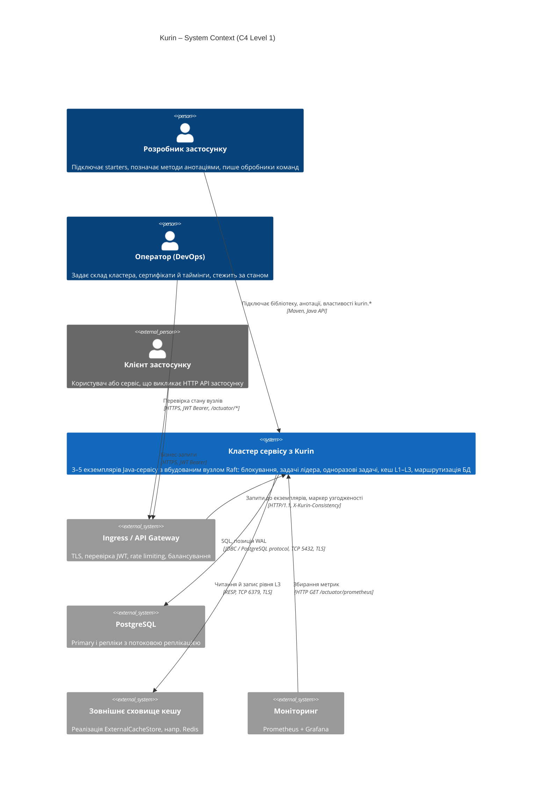
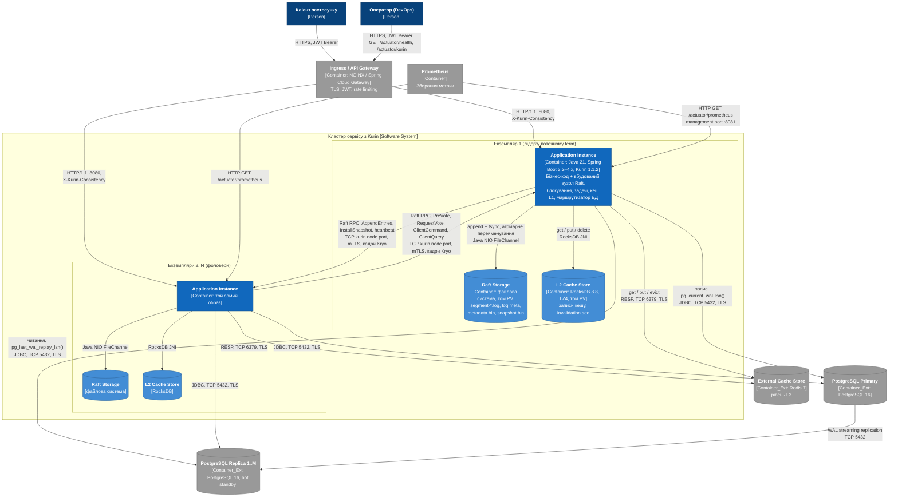
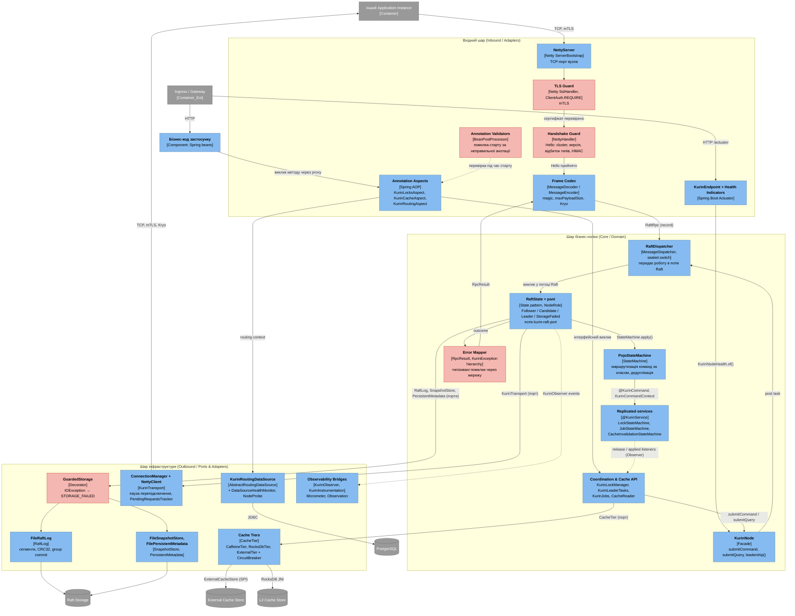

# РОЗДІЛ 2. ПРОЄКТУВАННЯ АРХІТЕКТУРИ СИСТЕМИ

Розділ спирається на інженерний контракт [srs.md](./srs.md) (ISO/IEC/IEEE 29148) і фіксує архітектуру Kurin за
моделлю C4 (рівні 1–3), архітектурні рішення ([adr/](./adr/)), модель даних, контракти протоколу й алгоритми
критичних вузлів. Діаграми записано кодом Mermaid і відображаються GitHub без додаткових інструментів.

Позначення трасування: `→ SRS-FUN-NN` – вимога, яку реалізує елемент; `→ ADR-NNN` – рішення, на якому він
ґрунтується.

---

## 2.1. Контекстне та контейнерне моделювання системи (C4 Model)

### 2.1.1. Рівень 1 – System Context

**Опис елементів рівня 1**

| Елемент | Тип | Роль | Трасування |
| :--- | :--- | :--- | :--- |
| Розробник застосунку | Person | Додає залежність starter, описує команди як Java-record і позначає методи `@KurinCommand`, `@KurinDistributedLock`, `@KurinCacheable`, `@KurinReadOnly`. | [SRS-FUN-30](./srs.md#srs-fun-30), [SRS-FUN-31](./srs.md#srs-fun-31) |
| Оператор | Person | Задає `kurin.node.peers`, сертифікати mTLS і `clusterSecret`; читає `/actuator/health` і `/actuator/kurin`. | [SRS-FUN-33](./srs.md#srs-fun-33) |
| Клієнт застосунку | Person_Ext | Викликає бізнес-API; між запитами переносить маркер узгодженості в заголовку `X-Kurin-Consistency`. | [SRS-FUN-26](./srs.md#srs-fun-26) |
| Кластер сервісу з Kurin | System | Межа системи: усі екземпляри сервісу разом із вбудованими вузлами Raft і їхніми локальними сховищами. | [SRS](./srs.md#1-контекст-системи-system-context) |
| Ingress / API Gateway | System_Ext | Термінує TLS клієнтів, перевіряє JWT, обмежує частоту запитів. Kurin власного HTTP-порту не має. | [SRS-CON-01](./srs.md#srs-con-01), [SRS-CON-07](./srs.md#srs-con-07) |
| PostgreSQL | System_Ext | Дані застосунку; primary приймає запис, репліки – читання. | [SRS-FUN-24](./srs.md#srs-fun-24) … [SRS-FUN-29](./srs.md#srs-fun-29) |
| Зовнішнє сховище кешу | System_Ext | Рівень L3, спільний для екземплярів; підключається реалізацією `ExternalCacheStore`. | [SRS-FUN-19](./srs.md#srs-fun-19) |
| Моніторинг | System_Ext | Забирає метрики Micrometer у форматі Prometheus. | [SRS-FUN-32](./srs.md#srs-fun-32) |

### 2.1.2. Рівень 2 – Container Diagram

Контейнер у C4 – окремо запущена одиниця виконання або сховище даних. Модулі Kurin (`core`, `kurin-locks`,
`kurin-tiered-cache`, `kurin-data-routing`, starters) **не є контейнерами**: вони збираються в один образ
застосунку і працюють у його JVM. Тому кластер складається з N однакових контейнерів Application Instance,
кожен із двома локальними томами.

**Опис контейнерів і зв'язків рівня 2**

| Контейнер | Технологія | Відповідальність | Трасування |
| :--- | :--- | :--- | :--- |
| Application Instance | Java 21, Spring Boot 3.2–4.x, Kurin 1.1.2 starters; образ OCI, один процес JVM | Бізнес-код і вбудований вузол Raft: вибори, реплікація, автомати блокувань і задач, читання кешу, вибір вузла БД. Декомпозицію наведено в [2.2](#22-компонентне-моделювання-критичного-сервісу-c4-level-3). | [SRS-FUN-01](./srs.md#srs-fun-01) … [SRS-FUN-33](./srs.md#srs-fun-33); [ADR-001](./adr/0001-choice-of-technology.md) |
| Raft Storage | Локальна файлова система (PersistentVolume для кожного екземпляра) | Сегменти журналу з CRC32, база журналу, term і голос, останній снапшот. Не спільна між екземплярами. | [SRS-FUN-05](./srs.md#srs-fun-05), [SRS-FUN-09](./srs.md#srs-fun-09) |
| L2 Cache Store | RocksDB 8.8 (вбудована, LZ4) на локальному томі | Записи кешу, що переживають перезапуск; номер останньої застосованої інвалідації. | [SRS-FUN-19](./srs.md#srs-fun-19), [SRS-FUN-23](./srs.md#srs-fun-23) |
| PostgreSQL Primary / Replica | PostgreSQL 16, потокова реплікація | Дані застосунку; маршрутизатор читає позиції WAL для маркера узгодженості. | [SRS-FUN-24](./srs.md#srs-fun-24) … [SRS-FUN-28](./srs.md#srs-fun-28) |
| External Cache Store | Redis 7 (приклад реалізації `ExternalCacheStore`) | Рівень L3 зі спільним вмістом; запис через впорядковані смуги, вимикач (circuit breaker). | [SRS-FUN-19](./srs.md#srs-fun-19) |
| Ingress / API Gateway | NGINX Ingress або Spring Cloud Gateway | TLS клієнтів, перевірка JWT (OAuth2 / OIDC), rate limiting, балансування між екземплярами. Поза межами Kurin. | [SRS-CON-01](./srs.md#srs-con-01), [SRS-CON-07](./srs.md#srs-con-07) |
| Prometheus | Prometheus 2.x | Pull-збирання метрик `kurin.*`. | [SRS-FUN-32](./srs.md#srs-fun-32) |

| Зв'язок | Протокол | Примітка |
| :--- | :--- | :--- |
| Лідер → фоловер | Raft RPC поверх TCP, TLS 1.2/1.3 з mTLS, кадр `magic\|type\|correlationId\|length\|Kryo` | `AppendEntries` (до 512 записів), `InstallSnapshot` частинами, heartbeat кожні 100 мс; [ADR-001](./adr/0001-choice-of-technology.md), [SRS-NFR-SEC-01](./srs.md#srs-nfr-sec-01) |
| Фоловер → лідер | те саме з'єднання-тип | `PreVote`, `RequestVote` (від кандидата), `ClientCommand` / `ClientQuery` – пересилання роботи застосунку [SRS-FUN-08](./srs.md#srs-fun-08) |
| Екземпляр → Raft Storage | Java NIO `FileChannel`, `force()` | дописування й `fsync` до підтвердження; `.tmp` → атомарне перейменування для метаданих і снапшота |
| Екземпляр → L2 | RocksDB JNI, у процесі | без мережі |
| Екземпляр → PostgreSQL | JDBC, PostgreSQL protocol, TCP 5432, TLS | вибір вузла – у першому SQL-запиті транзакції [SRS-FUN-24](./srs.md#srs-fun-24) |
| Екземпляр → L3 | RESP, TCP 6379, TLS (визначає реалізація) | асинхронні впорядковані записи |
| Gateway → екземпляр | HTTP/1.1, заголовок `X-Kurin-Consistency` | маркер підписано HMAC-SHA256 [SRS-NFR-SEC-03](./srs.md#srs-nfr-sec-03) |
| Prometheus → екземпляр | HTTP GET `/actuator/prometheus` на порту керування | порт керування закрито від клієнтів |

---

## 2.2. Компонентне моделювання критичного сервісу (C4 Level 3)

Для декомпозиції обрано контейнер **Application Instance**, а в ньому – вбудований вузол Kurin: він несе все
координаційне й обчислювальне навантаження (вибори, реплікація, застосування команд, кеш, маршрутизація).
Бізнес-код застосунку показано одним компонентом.

Червоним виділено компоненти захисту, валідації й обробки помилок.

**Опис компонентів**

| Шар | Компонент | Роль | Взаємодія | Трасування |
| :--- | :--- | :--- | :--- | :--- |
| Inbound | NettyServer | Приймає TCP-з'єднання вузлів-партнерів на `kurin.node.port`. | Netty pipeline | [ADR-001](./adr/0001-choice-of-technology.md) |
| Inbound | TLS Guard | `SslHandler` з `ClientAuth.REQUIRE`: з'єднання без сертифіката, підписаного довіреним центром, закривається до обміну даними. | Netty handler | [SRS-NFR-SEC-01](./srs.md#srs-nfr-sec-01) |
| Inbound | Handshake Guard | Першим повідомленням очікує `Hello`; порівнює ім'я кластера, версію протоколу, відбиток реєстру типів і HMAC-SHA256 над `clusterName\|nodeId\|nonce`; за розбіжності відповідає `HELLO_REJECT` з причиною. | Netty handler | [SRS-FUN-11](./srs.md#srs-fun-11) |
| Inbound | Frame Codec | Перевіряє `magic`, відхиляє кадр понад `maxPayloadSize`, десеріалізує лише зареєстровані типи Kryo. | Netty codec | [SRS-NFR-SEC-02](./srs.md#srs-nfr-sec-02), [SRS-NFR-RES-01](./srs.md#srs-nfr-res-01) |
| Inbound | Annotation Aspects | Перехоплюють методи з `@KurinDistributedLock`, `@KurinLeaderOnly`, `@KurinCacheable`, `@KurinCacheEvict`, `@KurinReadOnly`, `@KurinPrimary` і делегують API ядра; `KurinRoutingAspect` упорядковано перед транзакційним перехоплювачем. | Spring AOP proxy | [SRS-FUN-13](./srs.md#srs-fun-13), [SRS-FUN-19](./srs.md#srs-fun-19), [SRS-FUN-25](./srs.md#srs-fun-25) |
| Inbound | Annotation Validators | `KurinCoordinationRegistry`, `KurinCacheAnnotationValidator`: перевіряють анотації під час створення бінів. | `BeanPostProcessor` | [SRS-FUN-31](./srs.md#srs-fun-31) |
| Inbound | KurinEndpoint + Health | `/actuator/kurin` і health indicators; вердикт обчислюють класи без Spring (`KurinNodeHealth`), адаптери Boot 3 / 4 лише перекладають його. | Actuator | [SRS-FUN-33](./srs.md#srs-fun-33) |
| Core | KurinNode | Фасад вузла: `submitCommand`, `submitQuery`, `leadership()`, `status()`. | Java API | [SRS-FUN-03](./srs.md#srs-fun-03), [SRS-FUN-07](./srs.md#srs-fun-07) |
| Core | RaftDispatcher | Вичерпний `switch` за sealed-інтерфейсом `RaftRpc`; кожну роботу ставить у чергу потоку Raft. | `MessageDispatcher` | [SRS-CON-04](./srs.md#srs-con-04) |
| Core | RaftState + ролі | Однопотоковий стан вузла; ролі – патерн State (`NodeRole`); усі переходи в фоловера – через `stepDown`. | виклики в потоці Raft | [SRS-FUN-01](./srs.md#srs-fun-01) … [SRS-FUN-12](./srs.md#srs-fun-12) |
| Core | PojoStateMachine | Знаходить метод `@KurinCommand` / `@KurinQuery` за класом повідомлення; веде таблицю дедуплікації; збирає снапшот із `@KurinSnapshot` сервісів. | `StateMachine` | [SRS-FUN-04](./srs.md#srs-fun-04) |
| Core | Replicated services | Детерміновані автомати; час і маркер огородження – лише з `KurinCommandContext`. | DI через реєстрацію сервісів | [SRS-FUN-13](./srs.md#srs-fun-13), [SRS-FUN-18](./srs.md#srs-fun-18), [SRS-FUN-21](./srs.md#srs-fun-21) |
| Core | Coordination & Cache API | Очікування звільнення, компенсація невідомого результату, single flight, епохи інвалідацій. | інтерфейсні виклики; Observer від сервісів | [SRS-FUN-15](./srs.md#srs-fun-15), [SRS-FUN-16](./srs.md#srs-fun-16), [SRS-FUN-20](./srs.md#srs-fun-20), [SRS-FUN-22](./srs.md#srs-fun-22) |
| Core | Error Mapper | Усі публічні помилки – підкласи `KurinException`; через мережу передаються в `RpcResult(ok, value, errorType, errorMessage, leaderHint)`. | Global error handler протоколу | [SRS-FUN-09](./srs.md#srs-fun-09), [SRS-FUN-15](./srs.md#srs-fun-15) |
| Outbound | GuardedStorage | Декоратор над портами сховища: `UncheckedIOException` переводить вузол у `STORAGE_FAILED`. | Decorator | [SRS-FUN-09](./srs.md#srs-fun-09), [SRS-FUN-10](./srs.md#srs-fun-10) |
| Outbound | FileRaftLog | Реалізація порту `RaftLog`: сегменти по 8 МіБ, запис `length\|crc32\|Kryo(LogEntry)`, група записів на один `fsync`. | `RaftLog` | [SRS-FUN-05](./srs.md#srs-fun-05), [SRS-NFR-SCAL-02](./srs.md#srs-nfr-scal-02) |
| Outbound | FileSnapshotStore, FilePersistentMetadata | Снапшот і term/голос через `.tmp` → `fsync` → атомарне перейменування. | `SnapshotStore`, `PersistentMetadata` | [SRS-FUN-06](./srs.md#srs-fun-06) |
| Outbound | ConnectionManager + NettyClient | Одне вихідне з'єднання на вузол; пауза після невдалої спроби; запити протоколу Raft під час паузи завершуються одразу, пересилання роботи застосунку чекає наступної спроби. | `KurinTransport` | [SRS-FUN-08](./srs.md#srs-fun-08) |
| Outbound | Cache Tiers | L1 Caffeine, L2 RocksDB, L3 `ExternalTier` з вимикачем і впорядкованими записами за смугами ключів. | `CacheTier`, SPI `ExternalCacheStore` | [SRS-FUN-19](./srs.md#srs-fun-19) |
| Outbound | KurinRoutingDataSource | За `LazyConnectionDataSourceProxy`; монітор здоров'я з `NodeProbe` і класифікатором вичерпаного пулу. | `DataSource`, SPI `ShardResolver`, `ReplicaPositionProbe` | [SRS-FUN-24](./srs.md#srs-fun-24) … [SRS-FUN-29](./srs.md#srs-fun-29) |
| Outbound | Observability Bridges | Події `KurinObserver` → лічильники й таймери Micrometer; `KurinInstrumentation` → Observation (спани передаються лідеру в заголовках запиту). | Observer | [SRS-FUN-32](./srs.md#srs-fun-32) |

**Дотримання шарів і принципів.** Вхідний шар не звертається до сховищ: кадр проходить TLS → рукостискання →
кодек → `RaftDispatcher` → `RaftState`. Ядро залежить від портів (`RaftLog`, `SnapshotStore`,
`PersistentMetadata`, `KurinTransport`, `CacheTier`), а не від файлів і Netty (Dependency Inversion); реалізації
підставляються під час збирання вузла (`KurinNode.builder()`), тому `kurin-test` замінює транспорт і сховище
без зміни ядра. Автомати станів не знають про мережу й диск. Зворотні сповіщення від автоматів до API (звільнення
блокування, застосування інвалідації) – патерн Observer, щоб ядро не залежало від клієнтських класів.

---

## 2.3. Документування архітектурних рішень (Architecture Decision Records)

| ADR | Рішення | Статус | Зачеплені контейнери / компоненти |
| :--- | :--- | :--- | :--- |
| [ADR-001](./adr/0001-choice-of-technology.md) | Транспорт і серіалізація протоколу вузлів: Netty + Kryo з реєстром типів замість gRPC + Protocol Buffers | Approved | Application Instance: NettyServer, Handshake Guard, Frame Codec, ConnectionManager |

Нові рішення додаються файлами `docs/adr/NNNN-<назва>.md` за тим самим шаблоном.
