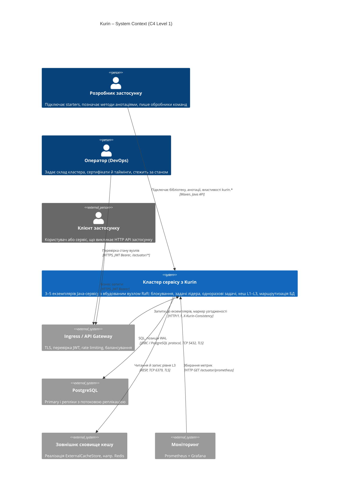
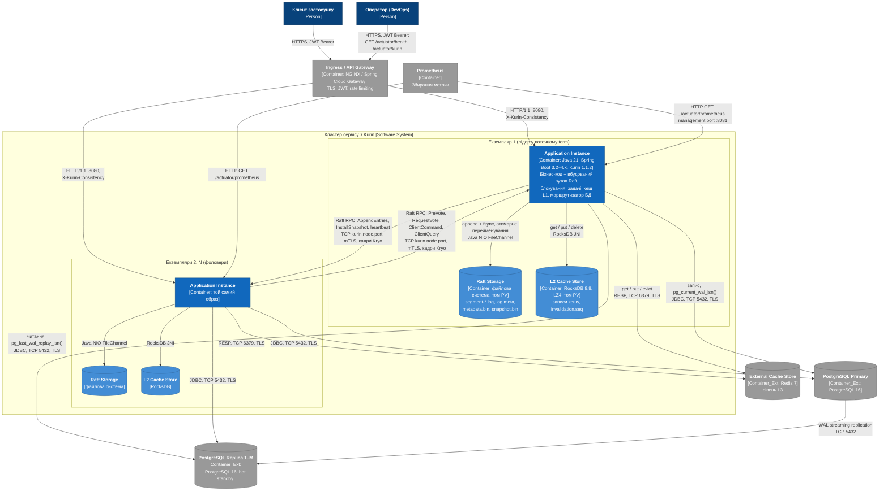
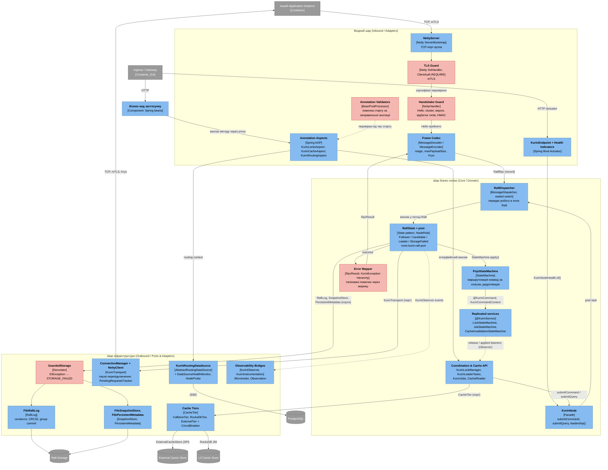
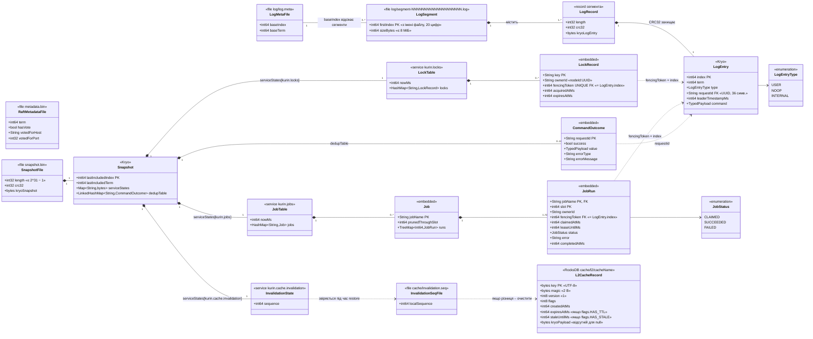
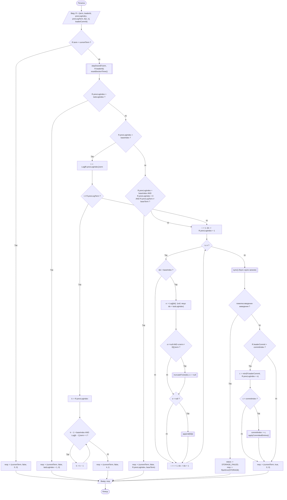
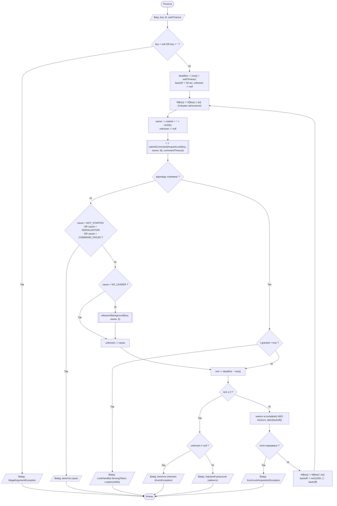
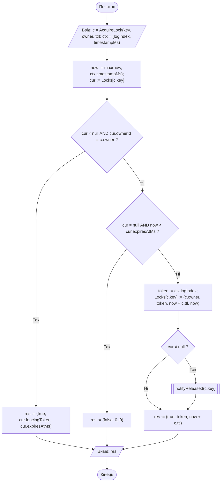
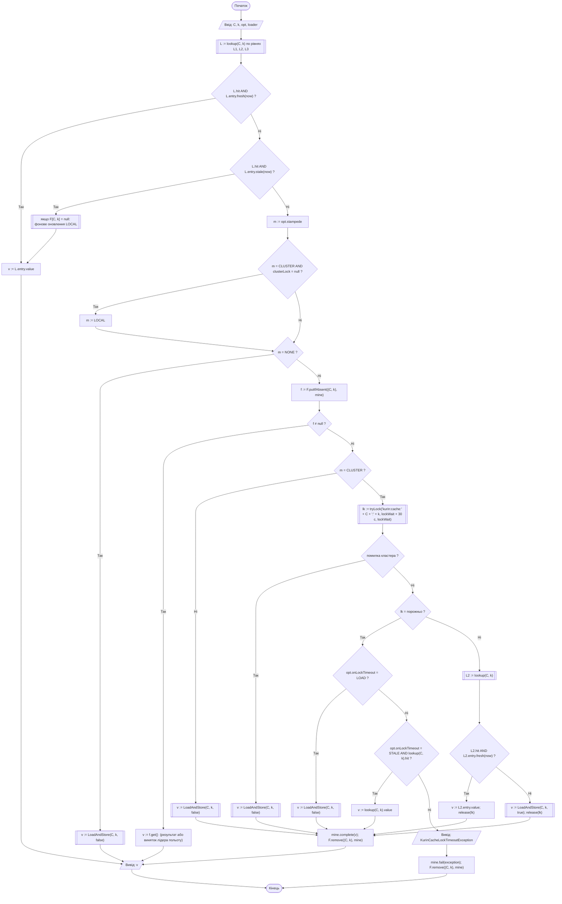
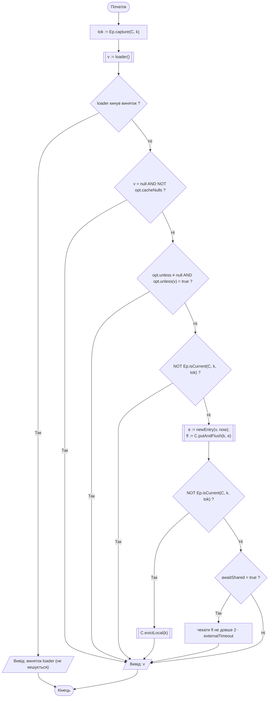

# РОЗДІЛ 2. ПРОЄКТУВАННЯ АРХІТЕКТУРИ СИСТЕМИ

Розділ спирається на інженерний контракт [srs.md](./srs.md) (ISO/IEC/IEEE 29148) і фіксує архітектуру Kurin за
моделлю C4 (рівні 1–3), архітектурні рішення ([adr/](./adr/)), модель даних, контракти протоколу й алгоритми
критичних вузлів. Діаграми записано кодом Mermaid і відображаються GitHub без додаткових інструментів.

Позначення трасування: `→ SRS-FUN-NN` – вимога, яку реалізує елемент; `→ ADR-NNN` – рішення, на якому він
ґрунтується.

---

## 2.1. Контекстне та контейнерне моделювання системи (C4 Model)

### 2.1.1. Рівень 1 – System Context

**Опис елементів рівня 1**

| Елемент | Тип | Роль | Трасування |
| :--- | :--- | :--- | :--- |
| Розробник застосунку | Person | Додає залежність starter, описує команди як Java-record і позначає методи `@KurinCommand`, `@KurinDistributedLock`, `@KurinCacheable`, `@KurinReadOnly`. | [SRS-FUN-30](./srs.md#srs-fun-30), [SRS-FUN-31](./srs.md#srs-fun-31) |
| Оператор | Person | Задає `kurin.node.peers`, сертифікати mTLS і `clusterSecret`; читає `/actuator/health` і `/actuator/kurin`. | [SRS-FUN-33](./srs.md#srs-fun-33) |
| Клієнт застосунку | Person_Ext | Викликає бізнес-API; між запитами переносить маркер узгодженості в заголовку `X-Kurin-Consistency`. | [SRS-FUN-26](./srs.md#srs-fun-26) |
| Кластер сервісу з Kurin | System | Межа системи: усі екземпляри сервісу разом із вбудованими вузлами Raft і їхніми локальними сховищами. | [SRS](./srs.md#1-контекст-системи-system-context) |
| Ingress / API Gateway | System_Ext | Термінує TLS клієнтів, перевіряє JWT, обмежує частоту запитів. Kurin власного HTTP-порту не має. | [SRS-CON-01](./srs.md#srs-con-01), [SRS-CON-07](./srs.md#srs-con-07) |
| PostgreSQL | System_Ext | Дані застосунку; primary приймає запис, репліки – читання. | [SRS-FUN-24](./srs.md#srs-fun-24) … [SRS-FUN-29](./srs.md#srs-fun-29) |
| Зовнішнє сховище кешу | System_Ext | Рівень L3, спільний для екземплярів; підключається реалізацією `ExternalCacheStore`. | [SRS-FUN-19](./srs.md#srs-fun-19) |
| Моніторинг | System_Ext | Забирає метрики Micrometer у форматі Prometheus. | [SRS-FUN-32](./srs.md#srs-fun-32) |

### 2.1.2. Рівень 2 – Container Diagram

Контейнер у C4 – окремо запущена одиниця виконання або сховище даних. Модулі Kurin (`core`, `kurin-locks`,
`kurin-tiered-cache`, `kurin-data-routing`, starters) **не є контейнерами**: вони збираються в один образ
застосунку і працюють у його JVM. Тому кластер складається з N однакових контейнерів Application Instance,
кожен із двома локальними томами.

**Опис контейнерів і зв'язків рівня 2**

| Контейнер | Технологія | Відповідальність | Трасування |
| :--- | :--- | :--- | :--- |
| Application Instance | Java 21, Spring Boot 3.2–4.x, Kurin 1.1.2 starters; образ OCI, один процес JVM | Бізнес-код і вбудований вузол Raft: вибори, реплікація, автомати блокувань і задач, читання кешу, вибір вузла БД. Декомпозицію наведено в [2.2](#22-компонентне-моделювання-критичного-сервісу-c4-level-3). | [SRS-FUN-01](./srs.md#srs-fun-01) … [SRS-FUN-33](./srs.md#srs-fun-33); [ADR-001](./adr/0001-choice-of-technology.md) |
| Raft Storage | Локальна файлова система (PersistentVolume для кожного екземпляра) | Сегменти журналу з CRC32, база журналу, term і голос, останній снапшот. Не спільна між екземплярами. | [SRS-FUN-05](./srs.md#srs-fun-05), [SRS-FUN-09](./srs.md#srs-fun-09) |
| L2 Cache Store | RocksDB 8.8 (вбудована, LZ4) на локальному томі | Записи кешу, що переживають перезапуск; номер останньої застосованої інвалідації. | [SRS-FUN-19](./srs.md#srs-fun-19), [SRS-FUN-23](./srs.md#srs-fun-23) |
| PostgreSQL Primary / Replica | PostgreSQL 16, потокова реплікація | Дані застосунку; маршрутизатор читає позиції WAL для маркера узгодженості. | [SRS-FUN-24](./srs.md#srs-fun-24) … [SRS-FUN-28](./srs.md#srs-fun-28) |
| External Cache Store | Redis 7 (приклад реалізації `ExternalCacheStore`) | Рівень L3 зі спільним вмістом; запис через впорядковані смуги, вимикач (circuit breaker). | [SRS-FUN-19](./srs.md#srs-fun-19) |
| Ingress / API Gateway | NGINX Ingress або Spring Cloud Gateway | TLS клієнтів, перевірка JWT (OAuth2 / OIDC), rate limiting, балансування між екземплярами. Поза межами Kurin. | [SRS-CON-01](./srs.md#srs-con-01), [SRS-CON-07](./srs.md#srs-con-07) |
| Prometheus | Prometheus 2.x | Pull-збирання метрик `kurin.*`. | [SRS-FUN-32](./srs.md#srs-fun-32) |

| Зв'язок | Протокол | Примітка |
| :--- | :--- | :--- |
| Лідер → фоловер | Raft RPC поверх TCP, TLS 1.2/1.3 з mTLS, кадр `magic\|type\|correlationId\|length\|Kryo` | `AppendEntries` (до 512 записів), `InstallSnapshot` частинами, heartbeat кожні 100 мс; [ADR-001](./adr/0001-choice-of-technology.md), [SRS-NFR-SEC-01](./srs.md#srs-nfr-sec-01) |
| Фоловер → лідер | те саме з'єднання-тип | `PreVote`, `RequestVote` (від кандидата), `ClientCommand` / `ClientQuery` – пересилання роботи застосунку [SRS-FUN-08](./srs.md#srs-fun-08) |
| Екземпляр → Raft Storage | Java NIO `FileChannel`, `force()` | дописування й `fsync` до підтвердження; `.tmp` → атомарне перейменування для метаданих і снапшота |
| Екземпляр → L2 | RocksDB JNI, у процесі | без мережі |
| Екземпляр → PostgreSQL | JDBC, PostgreSQL protocol, TCP 5432, TLS | вибір вузла – у першому SQL-запиті транзакції [SRS-FUN-24](./srs.md#srs-fun-24) |
| Екземпляр → L3 | RESP, TCP 6379, TLS (визначає реалізація) | асинхронні впорядковані записи |
| Gateway → екземпляр | HTTP/1.1, заголовок `X-Kurin-Consistency` | маркер підписано HMAC-SHA256 [SRS-NFR-SEC-03](./srs.md#srs-nfr-sec-03) |
| Prometheus → екземпляр | HTTP GET `/actuator/prometheus` на порту керування | порт керування закрито від клієнтів |

---

## 2.2. Компонентне моделювання критичного сервісу (C4 Level 3)

Для декомпозиції обрано контейнер **Application Instance**, а в ньому – вбудований вузол Kurin: він несе все
координаційне й обчислювальне навантаження (вибори, реплікація, застосування команд, кеш, маршрутизація).
Бізнес-код застосунку показано одним компонентом.

Червоним виділено компоненти захисту, валідації й обробки помилок.

**Опис компонентів**

| Шар | Компонент | Роль | Взаємодія | Трасування |
| :--- | :--- | :--- | :--- | :--- |
| Inbound | NettyServer | Приймає TCP-з'єднання вузлів-партнерів на `kurin.node.port`. | Netty pipeline | [ADR-001](./adr/0001-choice-of-technology.md) |
| Inbound | TLS Guard | `SslHandler` з `ClientAuth.REQUIRE`: з'єднання без сертифіката, підписаного довіреним центром, закривається до обміну даними. | Netty handler | [SRS-NFR-SEC-01](./srs.md#srs-nfr-sec-01) |
| Inbound | Handshake Guard | Першим повідомленням очікує `Hello`; порівнює ім'я кластера, версію протоколу, відбиток реєстру типів і HMAC-SHA256 над `clusterName\|nodeId\|nonce`; за розбіжності відповідає `HELLO_REJECT` з причиною. | Netty handler | [SRS-FUN-11](./srs.md#srs-fun-11) |
| Inbound | Frame Codec | Перевіряє `magic`, відхиляє кадр понад `maxPayloadSize`, десеріалізує лише зареєстровані типи Kryo. | Netty codec | [SRS-NFR-SEC-02](./srs.md#srs-nfr-sec-02), [SRS-NFR-RES-01](./srs.md#srs-nfr-res-01) |
| Inbound | Annotation Aspects | Перехоплюють методи з `@KurinDistributedLock`, `@KurinLeaderOnly`, `@KurinCacheable`, `@KurinCacheEvict`, `@KurinReadOnly`, `@KurinPrimary` і делегують API ядра; `KurinRoutingAspect` упорядковано перед транзакційним перехоплювачем. | Spring AOP proxy | [SRS-FUN-13](./srs.md#srs-fun-13), [SRS-FUN-19](./srs.md#srs-fun-19), [SRS-FUN-25](./srs.md#srs-fun-25) |
| Inbound | Annotation Validators | `KurinCoordinationRegistry`, `KurinCacheAnnotationValidator`: перевіряють анотації під час створення бінів. | `BeanPostProcessor` | [SRS-FUN-31](./srs.md#srs-fun-31) |
| Inbound | KurinEndpoint + Health | `/actuator/kurin` і health indicators; вердикт обчислюють класи без Spring (`KurinNodeHealth`), адаптери Boot 3 / 4 лише перекладають його. | Actuator | [SRS-FUN-33](./srs.md#srs-fun-33) |
| Core | KurinNode | Фасад вузла: `submitCommand`, `submitQuery`, `leadership()`, `status()`. | Java API | [SRS-FUN-03](./srs.md#srs-fun-03), [SRS-FUN-07](./srs.md#srs-fun-07) |
| Core | RaftDispatcher | Вичерпний `switch` за sealed-інтерфейсом `RaftRpc`; кожну роботу ставить у чергу потоку Raft. | `MessageDispatcher` | [SRS-CON-04](./srs.md#srs-con-04) |
| Core | RaftState + ролі | Однопотоковий стан вузла; ролі – патерн State (`NodeRole`); усі переходи в фоловера – через `stepDown`. | виклики в потоці Raft | [SRS-FUN-01](./srs.md#srs-fun-01) … [SRS-FUN-12](./srs.md#srs-fun-12) |
| Core | PojoStateMachine | Знаходить метод `@KurinCommand` / `@KurinQuery` за класом повідомлення; веде таблицю дедуплікації; збирає снапшот із `@KurinSnapshot` сервісів. | `StateMachine` | [SRS-FUN-04](./srs.md#srs-fun-04) |
| Core | Replicated services | Детерміновані автомати; час і маркер огородження – лише з `KurinCommandContext`. | DI через реєстрацію сервісів | [SRS-FUN-13](./srs.md#srs-fun-13), [SRS-FUN-18](./srs.md#srs-fun-18), [SRS-FUN-21](./srs.md#srs-fun-21) |
| Core | Coordination & Cache API | Очікування звільнення, компенсація невідомого результату, single flight, епохи інвалідацій. | інтерфейсні виклики; Observer від сервісів | [SRS-FUN-15](./srs.md#srs-fun-15), [SRS-FUN-16](./srs.md#srs-fun-16), [SRS-FUN-20](./srs.md#srs-fun-20), [SRS-FUN-22](./srs.md#srs-fun-22) |
| Core | Error Mapper | Усі публічні помилки – підкласи `KurinException`; через мережу передаються в `RpcResult(ok, value, errorType, errorMessage, leaderHint)`. | Global error handler протоколу | [SRS-FUN-09](./srs.md#srs-fun-09), [SRS-FUN-15](./srs.md#srs-fun-15) |
| Outbound | GuardedStorage | Декоратор над портами сховища: `UncheckedIOException` переводить вузол у `STORAGE_FAILED`. | Decorator | [SRS-FUN-09](./srs.md#srs-fun-09), [SRS-FUN-10](./srs.md#srs-fun-10) |
| Outbound | FileRaftLog | Реалізація порту `RaftLog`: сегменти по 8 МіБ, запис `length\|crc32\|Kryo(LogEntry)`, група записів на один `fsync`. | `RaftLog` | [SRS-FUN-05](./srs.md#srs-fun-05), [SRS-NFR-SCAL-02](./srs.md#srs-nfr-scal-02) |
| Outbound | FileSnapshotStore, FilePersistentMetadata | Снапшот і term/голос через `.tmp` → `fsync` → атомарне перейменування. | `SnapshotStore`, `PersistentMetadata` | [SRS-FUN-06](./srs.md#srs-fun-06) |
| Outbound | ConnectionManager + NettyClient | Одне вихідне з'єднання на вузол; пауза після невдалої спроби; запити протоколу Raft під час паузи завершуються одразу, пересилання роботи застосунку чекає наступної спроби. | `KurinTransport` | [SRS-FUN-08](./srs.md#srs-fun-08) |
| Outbound | Cache Tiers | L1 Caffeine, L2 RocksDB, L3 `ExternalTier` з вимикачем і впорядкованими записами за смугами ключів. | `CacheTier`, SPI `ExternalCacheStore` | [SRS-FUN-19](./srs.md#srs-fun-19) |
| Outbound | KurinRoutingDataSource | За `LazyConnectionDataSourceProxy`; монітор здоров'я з `NodeProbe` і класифікатором вичерпаного пулу. | `DataSource`, SPI `ShardResolver`, `ReplicaPositionProbe` | [SRS-FUN-24](./srs.md#srs-fun-24) … [SRS-FUN-29](./srs.md#srs-fun-29) |
| Outbound | Observability Bridges | Події `KurinObserver` → лічильники й таймери Micrometer; `KurinInstrumentation` → Observation (спани передаються лідеру в заголовках запиту). | Observer | [SRS-FUN-32](./srs.md#srs-fun-32) |

**Дотримання шарів і принципів.** Вхідний шар не звертається до сховищ: кадр проходить TLS → рукостискання →
кодек → `RaftDispatcher` → `RaftState`. Ядро залежить від портів (`RaftLog`, `SnapshotStore`,
`PersistentMetadata`, `KurinTransport`, `CacheTier`), а не від файлів і Netty (Dependency Inversion); реалізації
підставляються під час збирання вузла (`KurinNode.builder()`), тому `kurin-test` замінює транспорт і сховище
без зміни ядра. Автомати станів не знають про мережу й диск. Зворотні сповіщення від автоматів до API (звільнення
блокування, застосування інвалідації) – патерн Observer, щоб ядро не залежало від клієнтських класів.

---

## 2.3. Документування архітектурних рішень (Architecture Decision Records)

| ADR | Рішення | Статус | Зачеплені контейнери / компоненти |
| :--- | :--- | :--- | :--- |
| [ADR-001](./adr/0001-choice-of-technology.md) | Транспорт і серіалізація протоколу вузлів: Netty + Kryo з реєстром типів замість gRPC + Protocol Buffers | Approved | Application Instance: NettyServer, Handshake Guard, Frame Codec, ConnectionManager |

Нові рішення додаються файлами `docs/adr/NNNN-<назва>.md` за тим самим шаблоном.

---

## 2.4. Проєктування та моделювання баз даних

### 2.4.1. Тип сховища й обґрунтування

Kurin не має власної реляційної бази даних: PostgreSQL належить застосунку, а маршрутизатор лише читає позиції
WAL. Стан фреймворку зберігається в трьох нереляційних сховищах кожного екземпляра:

| Сховище | Тип | Що зберігає | Реплікується |
| :--- | :--- | :--- | :--- |
| Raft Storage | append-only журнал + файли «ключ – значення» на локальній файловій системі | журнал команд, term і голос, снапшот | вміст журналу й снапшота однаковий на всіх вузлах (Raft) |
| Реплікований стан у пам'яті | документні структури сервісів (`@KurinService`), відновлюються з журналу й снапшота | таблиця блокувань, слоти задач, лічильник інвалідацій, таблиця дедуплікації | так, застосуванням команд журналу |
| L2 Cache Store | key-value LSM-сховище RocksDB, одна база на кеш | записи кешу | ні; узгоджуються інвалідаціями |

Тому модель записано в синтаксисі `classDiagram` (NoSQL / Key-Value Schema): класи – файли, записи й
вкладені документи; стереотипи – тип сховища; `PK` – ключ пошуку, `FK` – посилання на ключ іншої структури.

### 2.4.2. Схема даних

### 2.4.3. Специфікація структур

**Raft Storage** (`<dataDir>/`, за замовчуванням `./kurin-data/<host>-<port>`)

| Структура | Поле | Тип | Обмеження | Опис |
| :--- | :--- | :--- | :--- | :--- |
| `metadata.bin` | `term` | int64 | ≥ 0, не зменшується | поточний term вузла |
| | `hasVote`, `votedForHost`, `votedForPort` | bool, UTF, int32 | голос лише при `hasVote = true` | кому віддано голос у `term`; записується до відповіді на `RequestVote` |
| `log/log.meta` | `baseIndex`, `baseTerm` | int64 | `baseIndex` = `lastIncludedIndex` снапшота або 0 | межа компактування журналу |
| `segment-<firstIndex>.log` | ім'я | 20 десяткових цифр | сортується лексикографічно = за індексом | сегмент до 8 МіБ; дописується лише активний |
| запис сегмента | `length`, `crc32`, `kryoLogEntry` | int32, int32, bytes | `length` ≤ `maxPayloadSize`; CRC32 по байтах `kryoLogEntry` | перший запис з неправильним CRC або розривом індексів – кінець корисних даних |
| `LogEntry` | `index` | int64 | `index = попередній + 1` | ключ журналу; на ньому побудовано маркери огородження |
| | `term` | int64 | ≥ 1; не спадає вздовж журналу | |
| | `type` | enum | `USER`, `NOOP`, `INTERNAL` | |
| | `requestId` | String | UUID (36 символів) або null для `NOOP` | ключ дедуплікації |
| | `leaderTimestampMs` | int64 | Unix epoch, мс, UTC | єдиний годинник автоматів станів |
| | `command` | Kryo-об'єкт | зареєстрований тип | |
| `snapshot.bin` | `length`, `crc32`, `kryoSnapshot` | int32, int32, bytes | `length` ≤ 2³¹ − 1; неправильний CRC → старт неможливий | |
| `Snapshot` | `lastIncludedIndex`, `lastIncludedTerm` | int64 | | позиція, яку заміщує снапшот |
| | `serviceStates` | `Map<serviceId, bytes>` | ключ – `@KurinService` id | бінарний стан від `@KurinSnapshot` кожного сервісу |
| | `dedupTable` | `LinkedHashMap<requestId, CommandOutcome>` | ≤ `dedupCacheSize` (10 000), порядок вставки | гарантує [SRS-FUN-04](./srs.md#srs-fun-04) після відновлення |

**Реплікований стан сервісів**

| Сервіс | Поле | Тип | Обмеження | Опис |
| :--- | :--- | :--- | :--- | :--- |
| `kurin.locks` | `nowMs` | int64 | `nowMs := max(nowMs, leaderTimestampMs)` | монотонний час автомата |
| `LockRecord` | `key` | String | непорожній | ключ блокування |
| | `ownerId` | String | `nodeId:UUID`, новий на кожну спробу | дозволяє компенсувати невідомий результат |
| | `fencingToken` | int64 | унікальний, строго зростає між наданнями | індекс запису з командою захоплення |
| | `acquiredAtMs`, `expiresAtMs` | int64 | `expiresAtMs = nowMs + ttl` | у часі журналу |
| `kurin.jobs` / `Job` | `jobName`, `prunedThroughSlot` | String, int64 | слоти ≤ `prunedThroughSlot` не захоплюються | |
| `JobRun` | `(jobName, slot)` | String, int64 | складений ключ | один запуск слоту |
| | `status` | enum | `CLAIMED → SUCCEEDED \| FAILED` | інших переходів немає |
| | `leaseUntilMs` | int64 | `claimedAtMs + leaseMs` | після нього `AT_LEAST_ONCE` дозволяє перехоплення |
| | `error`, `completedAtMs` | String, int64 | лише для `FAILED` / завершених | аудит запуску |
| `kurin.cache.invalidation` | `sequence` | int64 | +1 на кожну інвалідацію | лічильник застосованих інвалідацій |

**L2 Cache Store** (`cache/l2/<cacheName>/`, RocksDB, стиснення LZ4)

| Поле | Тип | Обмеження | Опис |
| :--- | :--- | :--- | :--- |
| ключ | bytes (UTF-8) | рядок ключа кешу | |
| `magic`, `version`, `flags` | 2 B, int8, int8 | `version = 1`; біти `NULL`, `HAS_TTL`, `HAS_STALE` | несумісна версія → запис ігнорується |
| `createdAtMs`, `expiresAtMs`, `staleUntilMs` | int64 | останні два – лише за відповідних прапорців | строк життя переноситься між рівнями |
| `kryoPayload` | bytes | класи – лише з дозволених пакетів (`KryoCacheCodec`) | [SRS-NFR-SEC-02](./srs.md#srs-nfr-sec-02) |
| `cache/invalidation.seq` | текст, int64 | записується після кожної застосованої інвалідації | порівнюється з `sequence` під час `restore` ([SRS-FUN-23](./srs.md#srs-fun-23)) |

### 2.4.4. Індекси й обґрунтування типів

| Структура доступу | Реалізація | Складність | Операція, яку прискорює |
| :--- | :--- | :--- | :--- |
| Індекс журналу за `index` | `ArrayList<LogEntry>` зі зсувом `baseIndex` | O(1) | `getEntry(i)` під час реплікації й перевірки `prevLogTerm` |
| Індекс сегментів за `firstIndex` | `TreeMap<Long, Path>` | O(log s) | `truncateFrom(i)`, видалення сегментів, покритих снапшотом |
| Блокування за ключем | `HashMap<String, LockRecord>` (хеш-індекс) | O(1) | `acquire`, `renew`, `release` |
| Запуски задачі за слотом | `TreeMap<Long, JobRun>` (впорядкований індекс) | O(log h) | `pollFirstEntry` для обрізання історії до `historySize` |
| Дедуплікація за `requestId` | `LinkedHashMap` з витісненням найстарішого | O(1) | перевірка повтору перед застосуванням |
| Записи кешу L2 за ключем | LSM-дерево RocksDB (memtable + SST, налаштування за замовчуванням, LZ4) | O(log n) читання, O(1) амортизований запис | читання L2 після промаху L1; Bloom-фільтр SST не ввімкнено – резерв оптимізації промахів L2 (Розділ 3) |
| Епохи інвалідацій за ключем | Caffeine з обмеженим розміром + `floor` | O(1) | перевірка, чи перетнулося завантаження з інвалідацією |

Обґрунтування типів:

- **int64 для індексів, term і часу.** int32 переповнюється після 2³¹ записів: за 5 000 команд/с
  ([SRS-NFR-PERF-02](./srs.md#srs-nfr-perf-02)) – приблизно за 5 діб.
- **Час – int64 Unix epoch, мс, UTC**, а не рядок дати: порівняння одним відніманням, без часових поясів; джерело –
  лише `leaderTimestampMs` ([SRS-CON-05](./srs.md#srs-con-05)).
- **`fencingToken` = індекс запису.** Окрема послідовність не потрібна: індекс уже унікальний і монотонний на всіх
  вузлах. Він же виконує роль версії для оптимістичного контролю на боці ресурсу.
- **CRC32 на запис журналу й снапшот** – виявлення пошкодженого хвоста після аварії ([SRS-FUN-05](./srs.md#srs-fun-05)).
- **Аудит змін** – сам журнал: кожна зміна блокування чи задачі є записом з `index`, `term`, `requestId` і часом
  лідера; окрема таблиця аудиту дублювала б журнал. Поля `acquiredAtMs`, `claimedAtMs`, `completedAtMs`, `error`
  виконують роль `created_at` / `updated_at`.
- **М'яке видалення не застосовується:** звільнене блокування видаляється з таблиці, бо його історія є в журналі
  до компактування; історія задач обмежена `historySize`.

### 2.4.5. Відомі обмеження моделі

| Обмеження | Наслідок | Рішення |
| :--- | :--- | :--- |
| `metadata.bin` без контрольної суми | пошкодження носія після запису не виявляється; атомарне перейменування захищає лише від частково записаного файла | Розділ 3: додати CRC32 і версію формату; старий формат читати без CRC |
| Еволюція полів класів Kryo | зміна полів команди робить старі записи нечитабельними ([ADR-001](./adr/0001-choice-of-technology.md), Consequences) | зміна класу команди – новий клас; рішення фіксується окремим ADR перед випуском 2.0 |
| `requestId` – рядок UUID (36 B) | на 20 B більше на запис, ніж 128-бітне число | залишено: формат журналу не змінюється до 2.0 |

---

## 2.5. Специфікація міжсервісних контрактів (API)

Kurin має два зовнішні інтерфейси, обидва з контейнера Application Instance ([C4 Container](#diagram-level2)):

| Інтерфейс | Між контейнерами | Формат контракту | Файл |
| :--- | :--- | :--- | :--- |
| Протокол вузлів | Application Instance ↔ Application Instance | proto3 (IDL); на дроті – кадр Kurin + Kryo ([ADR-001](./adr/0001-choice-of-technology.md)) | [kurin-raft.proto](./api/kurin-raft.proto) |
| Інтерфейс керування | Оператор / Prometheus → Gateway → Application Instance | OpenAPI 3.0.3 (YAML) | [openapi.yaml](./api/openapi.yaml) |

Деталізовану специфікацію повідомлень протоколу вузлів зафіксовано у файлі
[kurin-raft.proto](./api/kurin-raft.proto), ендпоінтів керування у форматі OpenAPI 3.0 – у файлі
[openapi.yaml](./api/openapi.yaml). Обидва файли пройшли синтаксичну перевірку (`protobufjs` 7, `swagger-parser` 10).

### 2.5.1. Протокол вузлів (`RaftPeerService`)

| Метод | Хто викликає | Призначення | Помилки | Вимоги |
| :--- | :--- | :--- | :--- | :--- |
| `Handshake` | сторона, що з'єднується | перевірка кластера, версії, відбитка типів, HMAC | `HELLO_REJECT` з причиною (≈ `UNAUTHENTICATED`) | [SRS-FUN-11](./srs.md#srs-fun-11) |
| `PreVote` | фоловер після таймауту виборів | згода на вибори без збільшення term | – | [SRS-FUN-01](./srs.md#srs-fun-01) |
| `RequestVote` | кандидат | голосування | – | [SRS-FUN-01](./srs.md#srs-fun-01) |
| `AppendEntries` | лідер | реплікація до 512 записів; heartbeat | `success = false` з `conflict_index`, `conflict_term`; `STORAGE` | [SRS-FUN-03](./srs.md#srs-fun-03), алгоритм [А1](#алгоритм-а1) |
| `InstallSnapshot` | лідер | передача снапшота частинами | `next_offset = 0` – передача заново | [SRS-FUN-06](./srs.md#srs-fun-06) |
| `SubmitCommand` | фоловер → лідер | пересилання команди застосунку, ідемпотентне за `request_id` | `NOT_LEADER` + `leader_hint`, `NO_LEADER`, `TIMEOUT`, `COMMAND_FAILED`, `SERIALIZATION`, `STORAGE` | [SRS-FUN-04](./srs.md#srs-fun-04), [SRS-FUN-08](./srs.md#srs-fun-08) |
| `SubmitQuery` | фоловер → лідер | читання з рівнем узгодженості | ті самі | [SRS-FUN-07](./srs.md#srs-fun-07) |

Безпека: TLS 1.2/1.3 з обов'язковим сертифікатом клієнта (mTLS) і HMAC-SHA256 рукостискання; токени на
кожен запит не використовуються, бо обидві сторони – процеси того самого застосунку з автентифікованим
з'єднанням ([SRS-NFR-SEC-01](./srs.md#srs-nfr-sec-01)). Обробка помилок: кожна відповідь – або тіло, або
`RpcError` з одним із восьми типів `ErrorType`, що збігаються з константами `RpcResult` у коді.

### 2.5.2. Інтерфейс керування (Actuator)

| Метод і шлях | Відповіді | Призначення |
| :--- | :--- | :--- |
| `GET /actuator/kurin` | 200 `KurinState`; 401, 403, 404, 429, 500 | стан вузла (роль, term, лідер, індекси, контакти з вузлами) і модулів |
| `GET /actuator/health/{kurin\|kurinCache\|kurinRouting}` | 200 (`UP`, `UNKNOWN`); 503 (`DOWN`, `OUT_OF_SERVICE`); 401, 403, 404, 429 | вердикт для балансувальника й оркестратора |

Безпека: `securitySchemes.bearerAuth` (JWT, scope `kurin.monitor`), перевірку виконує Spring Security застосунку
або шлюз ([SRS-CON-01](./srs.md#srs-con-01)); помилки – RFC 9457 `application/problem+json`.

---

## 2.6. Моделювання логіки критичних вузлів

Позначення в блоках: `:=` – присвоювання; `=`, `≠`, `<`, `≤` – порівняння; `AND`, `OR`, `NOT` – логічні операції;
`X[i]` – i-й елемент масиву або запис з ключем `i`. Форма блоків за ДСТУ ISO 5807: овал – термінатор,
прямокутник – процес, ромб – рішення, паралелограм – дані (введення / виведення), прямокутник з подвійними
боковими лініями – визначений процес (підпрограма).

### 2.6.1. Алгоритм А1 – обробка `AppendEntries` на фоловері

Реалізація: `FollowerRole.handleAppendEntries`. Вимоги: [SRS-FUN-03](./srs.md#srs-fun-03),
[SRS-FUN-05](./srs.md#srs-fun-05), [SRS-FUN-09](./srs.md#srs-fun-09). Виконується в потоці Raft.

Вхід: `R = (term, leaderId, prevLogIndex, prevLogTerm, E[1..n], leaderCommit)`, `0 ≤ n ≤ 512`. Стан:
`currentTerm`, журнал `Log[baseIndex+1 .. lastLogIndex]`, `baseIndex`, `baseTerm`, `commitIndex`.
Вихід: `(term, success, conflictIndex, conflictTerm)`.

Крайові випадки:

| Ситуація | Поведінка |
| :--- | :--- |
| `n = 0` (heartbeat) | цикл не виконується; оновлюється лише `commitIndex` і таймер виборів |
| застарілий лідер (`R.term < currentTerm`) | відмова з поточним term – лідер дізнається про новий term і складає повноваження |
| журнал фоловера коротший | `conflictIndex := lastLogIndex + 1` – лідер одразу переходить до потрібного індексу без покрокового спуску |
| конфлікт term | `conflictIndex` – перший запис конфліктного term; лідер пропускає весь term за один раунд |
| `prevLogIndex` всередині снапшота | записи з `idx ≤ baseIndex` пропускаються: вони вже зафіксовані й застосовані |
| збій диска під час `sync()` | підтвердження не надсилається; вузол переходить у `STORAGE_FAILED` ([SRS-FUN-09](./srs.md#srs-fun-09)) |
| скінченність | основний цикл обмежено `n ≤ 512`; зворотний пошук – `baseIndex` |

### 2.6.2. Алгоритм А2 – захоплення розподіленого блокування з очікуванням

Реалізація: `KurinLockManager.acquireWithWait` і `attempt` (клієнтська частина) та `LockStateMachine.acquire`
(рішення автомата). Вимоги: [SRS-FUN-13](./srs.md#srs-fun-13) … [SRS-FUN-16](./srs.md#srs-fun-16).

Вхід: `key`, `ttl`, `waitTimeout`. Вихід: дескриптор `(fencingToken, expiresAtMs)`, порожній результат
(«зайнято») або виняток `KurinException` («кластер не відповів»).

Визначений процес «застосування `AcquireLock`» на кожному вузлі (`LockStateMachine.acquire`, детермінований):

Крайові випадки:

| Ситуація | Поведінка |
| :--- | :--- |
| немає лідера (`NO_LEADER`) | команду не подано – компенсація не потрібна; повтор до `deadline` |
| тайм-аут або розрив з'єднання після подання | результат невідомий: звільнення з тим самим `owner` у фоні (до 5 спроб, пауза 50 · 2^j мс); `owner` унікальний, тому звільнення не зачіпає чуже блокування |
| помилка, яку очікування не виправить | `NOT_STARTED`, `SERIALIZATION`, `COMMAND_FAILED` – виняток одразу |
| повторне застосування тієї самої команди | `cur.ownerId = c.owner` – той самий маркер, без нового надання |
| годинник лідера пішов назад після виборів | `now := max(now, ...)` – час автомата не зменшується |
| скінченність | цикл обмежено `deadline`; очікування – подією звільнення або `jitter(backoff) ≤ 1 с`; кількість команд не зростає з кількістю потоків, що чекають |

### 2.6.3. Алгоритм А3 – читання багаторівневого кешу із завантаженням за промахом

Реалізація: `CacheReader.read`, `singleFlight`, `loadUnderClusterLock`, `loadAndStore`. Вимоги:
[SRS-FUN-19](./srs.md#srs-fun-19) … [SRS-FUN-22](./srs.md#srs-fun-22).

Вхід: кеш `C`, ключ `k`, параметри `opt` (`stampede ∈ {NONE, LOCAL, CLUSTER}`, `cacheNulls`, `unless`,
`lockWait`, `onLockTimeout ∈ {LOAD, FAIL, STALE}`), завантажувач `loader`. `F` – таблиця завантажень, що
виконуються; `Ep` – епохи інвалідацій.

Визначений процес `LoadAndStore(C, k, awaitShared)`:

Крайові випадки:

| Ситуація | Поведінка |
| :--- | :--- |
| інвалідація під час завантаження | `Ep.isCurrent = false` до запису – значення повертається, але не кешується; після запису – видаляється ([SRS-FUN-22](./srs.md#srs-fun-22)) |
| помилка джерела (`loader`) | виняток отримують власник і всі, хто чекав на `F[C, k]`; запис у `F` видаляється у `finally` – наступний виклик пробує знову |
| `loader` повернув null | кешується маркер `KurinNullValue` лише за `cacheNulls = true` |
| немає модуля блокувань | `CLUSTER` → `LOCAL` з одним попередженням у журналі подій |
| кластер не відповів на `tryLock` | завантаження без блокування (доступність важливіша за дублювання одного завантаження) |
| L3 недоступний | `ExternalTier` за вимикачем; очікування підтвердження L3 обмежено `2 · externalTimeout` |
| застаріле значення | віддається одразу; оновлення – одне на ключ у фоні; помилка оновлення залишає застаріле значення |

---

## 2.7. Інтеграційний аудит та верифікація цілісності доменів

### 2.7.1. Production Readiness Report

**Об'єкт аудиту:** модель даних ([2.4](#24-проєктування-та-моделювання-баз-даних)), контракти
([kurin-raft.proto](./api/kurin-raft.proto), [openapi.yaml](./api/openapi.yaml)), алгоритми А1–А3
([2.6](#26-моделювання-логіки-критичних-вузлів)), звірені з кодом Kurin 1.1.2 (`core/.../raft/rpc`,
`RpcResult`, `KurinNodeHealth`, `LockStateMachine`, `JobStateMachine`, `CacheReader`).

**Висновок:** специфікації узгоджені й готові до використання в Розділі 3 (реалізація та тестування).
Блокерів (showstoppers) – **0**. Виявлено 9 розбіжностей; 7 виправлено в документації, 2 зафіксовано як
обмеження з планом.

| № | Перевірка | Розбіжність | Серйозність | Виправлення | Статус |
| :---: | :--- | :--- | :---: | :--- | :---: |
| 1 | API ↔ код: вміст частини `InstallSnapshot` | контракт описував частину як `length\|crc32\|Kryo` (формат файла `snapshot.bin`); лідер передає `Kryo(Snapshot)` без заголовка й CRC | Minor | коментар у `.proto` виправлено; цілісність передачі – MAC записів TLS і CRC файла після встановлення | ✅ |
| 2 | API ↔ дані ↔ SRS: розмір снапшота | `offset` і `next_offset` – `int32`, `snapshot.bin` має `length:int32`, але обмеження розміру не було в SRS і моделі даних | Major | обмеження «снапшот ≤ 2³¹ − 1 байт» додано в 2.4 і в SRS ([SRS-NFR-RES-03](./srs.md#srs-nfr-res-03)) | ✅ |
| 3 | API ↔ дані: ідентифікатор вузла | `.proto`: `NodeAddress {host, port}`; OpenAPI і `RaftStatus.leaderId`: рядок `host:port` | Minor | відображення `NodeAddress.asString()` зафіксовано; у OpenAPI – схема `NodeId` з `pattern` | ✅ |
| 4 | API ↔ код: `requestId` у записі `NOOP` | у коді `null`; у proto3 поле `string` не має значення `null` | Minor | правило відображення: порожній рядок ↔ `null` (коментар у `.proto`, табл. 2.4.3) | ✅ |
| 5 | API ↔ код: причина `COMMAND_FAILED` | `RpcResult` передає клас винятку обробника в полі `value`, а не в `errorMessage`; у контракті поля для цього не було | Major | додано `RpcError.failed_cause_type` | ✅ |
| 6 | SRS ↔ код: версія TLS | SRS вимагав TLS 1.3; `SslContexts` не фіксує протокол – діють протоколи JDK 21 (TLS 1.3 і 1.2) | Minor | SRS-NFR-SEC-01 уточнено: «TLS 1.2 / 1.3, mTLS»; фіксація TLS 1.3 – Розділ 3 | ✅ |
| 7 | SRS ↔ тести: верифікація SRS-NFR-RES-02 | критерій посилався на неіснуючий тест витіснення з таблиці дедуплікації | Minor | статус критерію – «плановий»; тест – Розділ 3 | ✅ |
| 8 | Дані: `metadata.bin` без CRC | пошкодження носія не виявляється | Major | обмеження в 2.4.5; CRC32 і версія формату – Розділ 3 | 📋 план |
| 9 | Дані ↔ ADR-001: еволюція класів Kryo | зміна полів команди ламає читання старих записів | Major | обмеження в ADR-001 і 2.4.5; окремий ADR до 2.0 | 📋 план |

**Перехресні перевірки без розбіжностей**

| Сутність | Модель даних | Контракт | Алгоритм | Код |
| :--- | :--- | :--- | :--- | :--- |
| індекс, term, час | int64, мс epoch UTC | `int64` (proto), `integer/int64` (OpenAPI) | А1, А2 | `long` |
| тип запису журналу | `USER`, `NOOP`, `INTERNAL` | `EntryType` (3 значення + `UNSPECIFIED`) | А1 | `LogEntryType` |
| типи помилок | – | `ErrorType`: 8 значень, імена = константи `RpcResult` | А2 (`NO_LEADER`, `NOT_STARTED`, `SERIALIZATION`, `COMMAND_FAILED`) | `RpcResult.ERROR_*` |
| час блокування | `expiresAtMs = nowMs + ttl` у часі журналу | – | А2: `now := max(now, ctx.timestampMs)` | `LockStateMachine.advanceClock` |
| ролі вузла | – | `FOLLOWER`, `CANDIDATE`, `LEADER` | А1 (`stepDown`) | `RaftRole` |
| статус здоров'я | – | `UP`, `UNKNOWN`, `OUT_OF_SERVICE`, `DOWN`; 503 для двох останніх | – | `KurinNodeHealth.Status`, Actuator |
| `commandPath` | – | `UP`, `CONNECTING`, `DOWN` | – | `CommandPath` |
| рівні читання | – | `LINEARIZABLE`, `LEASE`, `LOCAL` | – | `ReadConsistency` |
| статус задачі | `CLAIMED`, `SUCCEEDED`, `FAILED` | розділ `coordination` в `/actuator/kurin` | – | `JobStatus` |
| `conflictIndex`, `conflictTerm` | – | `AppendEntriesResponse` | А1 | `AppendEntriesResponse` |
| епохи інвалідацій | локальні, не реплікуються | – | А3 | `InvalidationEpochs` |

### 2.7.2. Чек-лист готовності

| Критерій | Стан |
| :--- | :---: |
| Кожна сутність моделі даних має ключ і тип; зв'язки мають кратність | ✅ |
| Кожне поле контрактів відповідає полю коду з тим самим типом і розмірністю | ✅ |
| Кожна помилка коду має тип у контракті | ✅ |
| Кожен алгоритм має обмежені цикли й поведінку для порожнього входу та відмови залежності | ✅ |
| Діаграми Mermaid проходять парсер Mermaid 11; `.proto` – `protobufjs`; OpenAPI – `swagger-parser` | ✅ |
| Кожен елемент C4 і кожен алгоритм посилається на вимоги SRS | ✅ |
| Відомі обмеження мають власника й розділ виконання | ✅ |
